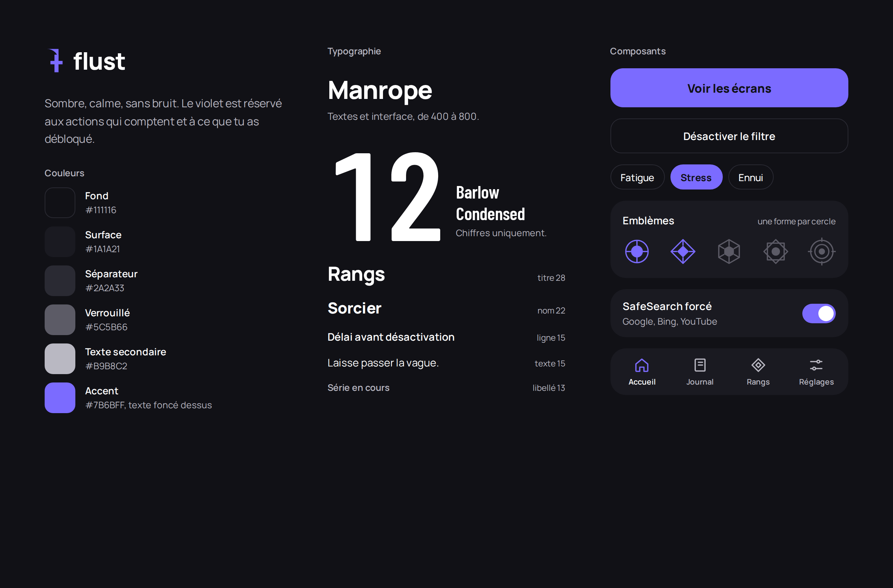
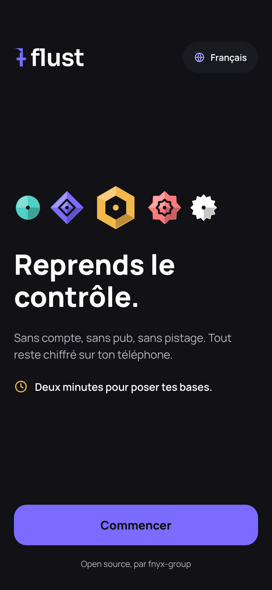
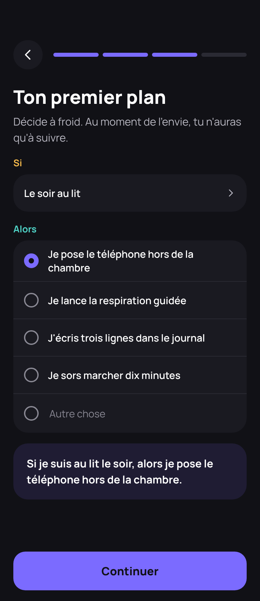
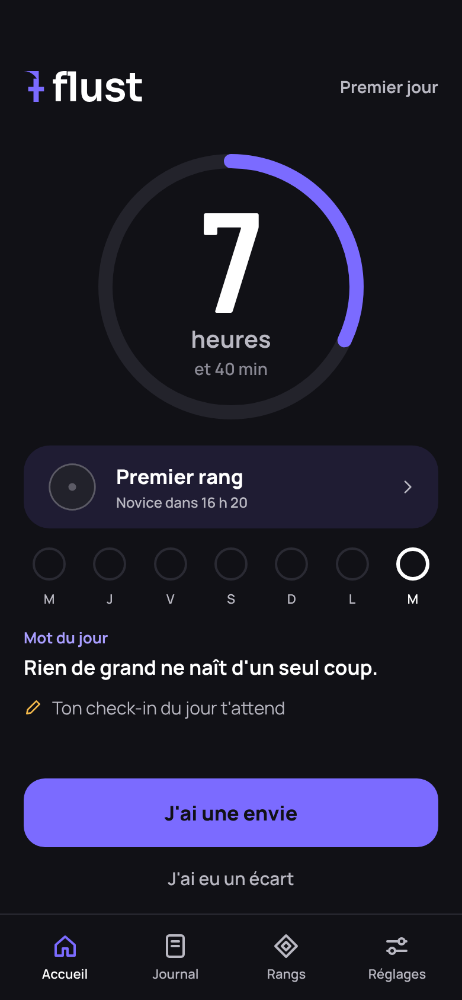
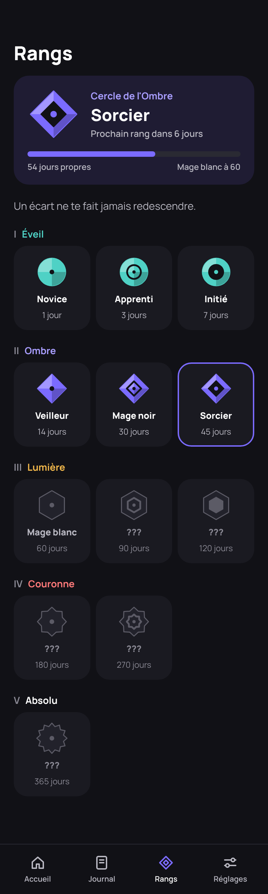
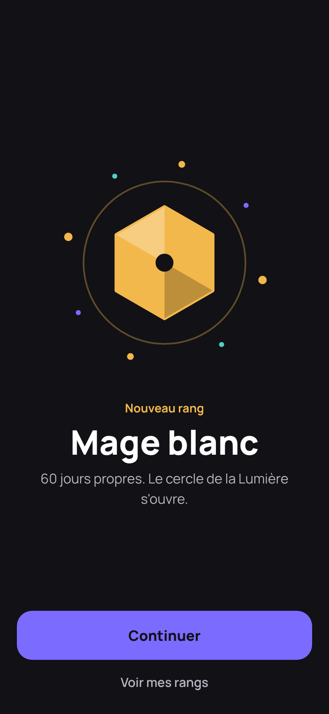
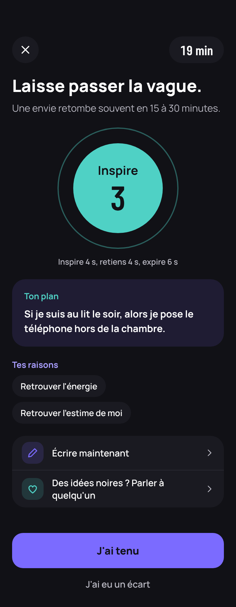
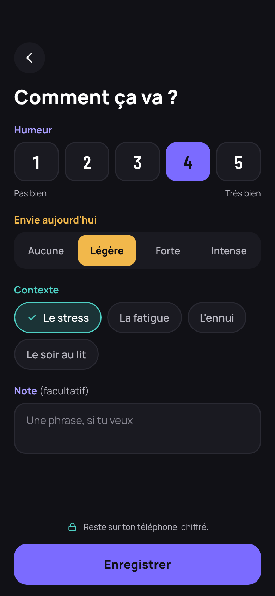
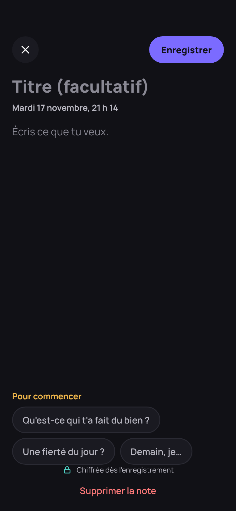
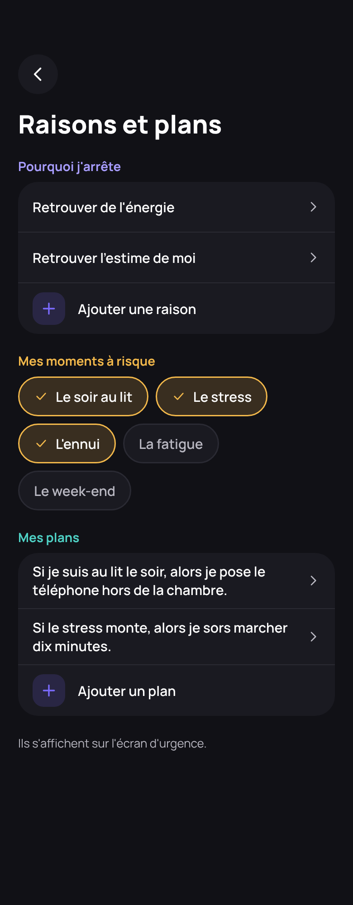

# Design system

This document defines the visual language of flust: colors, typography, layout, navigation and tone. The app uses a single dark theme.

## Colors

| Token          | Value     | Use                                                               |
| -------------- | --------- | ----------------------------------------------------------------- |
| Background     | `#111116` | Screen background                                                 |
| Surface        | `#1A1A21` | Cards                                                             |
| Separator      | `#2A2A33` | Separators                                                        |
| Locked         | `#5C5B66` | Locked ranks and emblems, days before the start in the week strip |
| Secondary text | `#B9B8C2` | Labels and secondary text                                         |
| Text           | `#FFFFFF` | Primary text                                                      |
| Accent         | `#7B6BFF` | See below                                                         |

Text on the accent color is always `#111116`.

The accent is reserved for primary actions, progress, unlocked emblems, the active tab, the clean days of the home week strip and the bar beside the daily quote. It is not used otherwise for decoration.

No gradients. No emojis.

## Typography

Two typefaces, bundled with the app:

- Manrope, weights 400 to 800, for the whole interface.
- Barlow Condensed, weights 500 and 600, for numbers only.

Counters use tabular numbers so digits do not shift as they change.

| Style                             | Size  | Weight | Notes                 |
| --------------------------------- | ----- | ------ | --------------------- |
| Streak counter, 1 or 2-digit days | 226   | 600    | Barlow Condensed      |
| Streak counter, 3-digit days      | 150   | 600    | Barlow Condensed      |
| Streak counter, 4-digit days      | 113   | 600    | Barlow Condensed      |
| Streak counter, 1-digit hours     | 141   | 600    | Barlow Condensed      |
| Streak counter, 2-digit hours     | 105   | 600    | Barlow Condensed      |
| Streak counter unit               | 40    | 600    | Secondary text color  |
| Welcome title                     | 40    | 800    | Onboarding welcome    |
| Brand lockup                      | 36    | 800    | Onboarding welcome    |
| Unlocked rank name                | 40    | 800    | Rank unlock screen    |
| Breathing count                   | 56    | 600    | Barlow Condensed      |
| Lapse summary number              | 48    | 600    | Barlow Condensed      |
| Stepper value                     | 32    | 600    | Barlow Condensed      |
| Wheel, selected row               | 30    | 600    | Barlow Condensed      |
| Wheel, other rows                 | 22    | 500    | Barlow Condensed      |
| Countdown                         | 22    | 600    | Barlow Condensed      |
| Breathing phase                   | 20    | 600    |                       |
| Screen title                      | 28    | 800    |                       |
| Rank name                         | 22    | 800    |                       |
| Daily quote                       | 19    | 700    | Line height 26        |
| Calendar day                      | 18    | 500    | Barlow Condensed      |
| Mood value                        | 22    | 600    | Check-in mood scale   |
| Select value                      | 17    | 800    | Value of a select row |
| Row                               | 15    | 600    |                       |
| Rank badge name                   | 15    | 800    |                       |
| Primary button                    | 17    | 800    | Text on accent        |
| Secondary button                  | 15    | 600    |                       |
| Body                              | 15-16 | 400    |                       |
| Section label                     | 16    | 600    | Secondary text color  |
| Unlock label                      | 14    | 700    | Accent, uppercase     |
| Label                             | 13    | 600    | Secondary text color  |
| Caption                           | 12    | 400    |                       |
| Rank badge detail                 | 12    | 600    | Secondary text color  |
| Weekday initial                   | 11    | 600    | Secondary text color  |

The streak counter is not in a card: it spans the screen width minus the screen padding, 320 points on a 360 point wide screen and 350 on a 390 point one. Its size is the largest that keeps it on one line, units included, at 320 points in both languages. Days use 226 up to 99, 150 up to 999, then 113. Hours have their own sizes, since " h " and " min" take more room than " jours": 141 for "7 h 40 min" and 105 for "12 h 05 min", with minutes always shown on two digits. A test measures the widest counter of each size with the fonts' glyph widths, and checks that one point more would no longer fit. Only screens narrower than 360 points shrink the counter further to fit.

The counter, digits and units together, does not grow with the system text size, since it is already the largest text on screen. Screen readers read it as one sentence, such as "Série en cours : 7 heures 40 minutes". Every other text grows with the system text size.

## Layout

| Element            | Value                         |
| ------------------ | ----------------------------- |
| Screen padding     | 20                            |
| Top padding        | 60                            |
| Cards              | Radius 20 to 22               |
| Primary button     | Height 58, radius 18          |
| Secondary button   | Height 48 to 50, radius 16    |
| Chips              | Pill shape                    |
| Segmented controls | Radius 16, segments radius 12 |
| Switches           | 48 by 28                      |
| Touch targets      | At least 44 by 44             |

### Scrolling

Scrolling content never stretches at its ends on Android: the over-scroll effect of Android 12 and later is turned off on every scroll view and list. iOS keeps its default bounce. Every scrolling container uses `ScrollView` from `src/ui/scroll-view.tsx`, which sets this once; ESLint rejects `ScrollView`, `FlatList`, `SectionList` and `VirtualizedList` imported from `react-native` elsewhere. The same file holds `SectionList`, for long lists in sections such as the journal. A list needed later gets its own wrapper in that file.

## Navigation

The tab bar has four tabs: Home, Journal, Ranks and Settings. Tab icons are line icons. The active tab icon uses the accent color.

The emergency screen is not a tab. It is reached from the emergency button on the home screen.

The home header shows the flust symbol with the name next to it. The lock screen shows the same symbol and name, larger and centered.

Full screens shown over the others (emergency, note, lapse, rank unlocked) slide up from the bottom as cards, without the swipe to dismiss. They are not native modals, which would sit above the lock cover.

## Home

From top to bottom, with the screen padding of 20:

1. A header row: the brand lockup on the left, the rank badge on the right.
2. One block, without a card, centered vertically in the free space between the header and the button: the "Série en cours" label, the streak counter, the week strip, then the daily quote. The week strip and the quote are 40 points apart. The free space goes above and below the block, never between its parts.
3. At the bottom: the "J'ai une envie" button, then the discreet "J'ai eu un écart" text button.

Under the quote, 8 points below it and part of the same block, one line in secondary body text: "Check-in du jour · à faire", or "Check-in fait" once today's check-in is saved. It opens the check-in and is read as one button. It never uses the accent color, so a missed check-in never looks like a failure.

After several low mood check-ins, a card sits above the "J'ai une envie" button, outside the centered block so the counter stays in place: surface color, radius 22, the suggestion in text color and the emergency line in secondary text (15/400, line height 22), then "Voir les numéros d'aide", a text button (15/600, text color) that opens the help screen, and a close button on the right. No red, no accent, no animation. Closing it hides it until the next local day.

For six hours after a lapse is logged, one supportive line in secondary text sits above the "J'ai une envie" button. Until local midnight after a lapse is logged, and at least an hour, a caption line "Écart noté · Annuler l'écart" sits under the text button; "Annuler l'écart" is a text button. Neither uses red, the record streak or an animation.

### Rank badge

A pill on the surface color (radius full, padding 4 12 4 4). It holds a 56 point progress ring, with a 3 point stroke, a separator track and accent progress, and the 28 point rank emblem inside. A text column follows: the rank name (15/800) and a secondary line (12/600).

| Moment              | Name         | Secondary line             | Ring                                  |
| ------------------- | ------------ | -------------------------- | ------------------------------------- |
| Before day one      | Premier rang | "Novice dans 16 h 20"      | Current streak toward 24 hours        |
| With a next rank    | Current rank | "Mage blanc dans 2 jours"  | Total clean days toward its threshold |
| After the last rank | Current rank | "Tous les rangs débloqués" | Full                                  |

Before day one, the emblem is the first rank's, in the locked color. The badge opens the ranks tab. Screen readers read it as one button, such as "Sorcier, Mage blanc dans 2 jours".

### Week strip

The last 7 local days, today on the right. Each day is a bar (height 6, radius 3) with its weekday initial under it (11/600, secondary text color). The initials come from the platform's locale data in the app language.

| Day                | Bar                   | Initial        |
| ------------------ | --------------------- | -------------- |
| Clean              | Accent                | Secondary text |
| Today, in progress | Accent at 50% opacity | Secondary text |
| With a lapse       | Separator             | Secondary text |
| Before the start   | None                  | Locked         |

Days before the journey start show no bar, only their initial, so the first week fills up day by day instead of starting with grey bars. A day with a lapse keeps a neutral separator bar: the strip never uses red or crosses. Today turns to the separator color once a lapse is logged. Days change at local midnight, like the daily quote. Screen readers read the strip as one summary, such as "6 jours propres sur les 7 derniers".

### Daily quote

No title. A 3 point accent bar runs along the left of the quote (19/700, line height 26), with the author under it in secondary text when there is one. Screen readers read it as one label starting with "Mot du jour", followed by the author.

## Ranks

From top to bottom, in a scrolling screen with the screen padding of 20 and 24 points between blocks:

1. The "Rangs" screen title.
2. A card (radius 22, padding 20) with the 64 point emblem of the current rank on the left. On the right: the circle label, such as "Cercle II · Ombre" (section label), followed by the rarity stars, then the rank name (22/800) and "Prochain rang dans 13 jours" (body, secondary text). Before day one it shows "Premier rang" and the time left to Novice, with the emblem and stars in the locked color.
3. The rule, "Ton rang suit tes jours propres au total. Un écart ne te fait jamais redescendre." (16/400, line height 24, secondary text).
4. The twelve ranks in 3 columns, 8 points apart. Each cell is a card (radius 20) with the 36 point emblem, the name (15/800), the stars and the threshold (body, secondary text).

| Rank         | Emblem | Name                 | Stars  | Outline |
| ------------ | ------ | -------------------- | ------ | ------- |
| Unlocked     | Accent | Its name, text color | Text   | None    |
| Current      | Accent | Its name, text color | Text   | Accent  |
| Next         | Locked | Its name, secondary  | Locked | None    |
| Other locked | Locked | "???", locked color  | Locked | None    |

### Rarity stars

Stars show the circle number: one in circle I, five in circle V. They are drawn as SVG, 10 points on the ranks screen and 18 on the unlock screen, never on the home badge. Screen readers skip them, since each label already names the circle. Screen readers read the circle as a number ("cercle 2"), since they spell out Roman numerals.

Each grid cell is read as one label: name or "Rang verrouillé", circle, state and threshold, such as "Sorcier, cercle 2, rang actuel, 45 jours".

## Rank unlock screen

A full screen, without the tab bar. Centered in the free space: three rings, 300 points wide (an outer one in the surface color, a middle one in the separator color, a dashed accent one), with the 120 point emblem in accent inside them. Under them: "Nouveau rang" (unlock label), the rank name (40/800), the stars, then the total clean days and the circle line (16/400, line height 24, secondary text). Other ranks unlocked at the same time are listed below in body text. At the bottom, the "Continuer" primary button and the "Voir mes rangs" text button.

The screen reveals itself in about 900 milliseconds: the rings fade in, then the emblem fades in while growing from 85 to 100 percent, then the text rises 8 points into place. With reduce motion on, everything shows at once. Screen readers announce "Nouveau rang : Mage blanc, cercle 3, Lumière" when the screen opens.

## Emergency screen

A full screen without the tab bar, in a scrolling column with 24 points between blocks:

1. A header row: the close button on the left, the countdown chip on the right (a pill on the surface color, 22/600 Barlow Condensed, from 20:00 to 00:00). Screen readers read it in words, such as "Encore 19 minutes 42 secondes".
2. "Laisse passer la vague." (screen title) and the explanation (16/400, line height 24, secondary text). Once the countdown reaches zero, "La vague est passée ?" (row style) appears under it and is announced once.
3. The breathing guide: a 220 point ring in the separator color around a 170 point circle on the surface color with a 3 point accent stroke. The circle grows from 70 to 100 percent on the inhale, stays on the hold and shrinks on the exhale. The phase name (20/600) and the seconds left in the phase (56/600 Barlow Condensed) sit in the middle and do not scale. The rhythm is written under it in secondary body text. With reduce motion on, the circle keeps its size and only the text changes. Screen readers hear the rhythm once when the screen opens. The ring is one element, "Guide de respiration", whose value is the phase name; screen readers read the phase again as it changes only while that element has focus, and never the seconds.
4. The plan card ("Ton plan", or "Tes plans" with several, then one sentence per plan, and an "Écrire maintenant" secondary button when a plan is to write in the journal, which opens a new note over the screen) and the reasons card ("Tes raisons", one line per reason), on the surface color with radius 22. Each card only shows when it has content.
5. At the bottom: "J'ai tenu" (primary), "J'ai eu un écart" (text button), then "Des idées noires ? Parler à quelqu'un" (text button), for dark thoughts rather than urges. It opens the help screen over the emergency screen, which keeps running underneath.

## Lapse screen

A full screen without the tab bar. A header row holds the back button on the left and the "Passer" text button on the right. Below it, scrolling:

1. "Un écart, pas un retour à zéro." (screen title) and "Tes jours propres restent acquis. On repart d'ici." (16/400, secondary text).
2. Two cards side by side (radius 22): the total clean days kept and the streak that just ended, each a 48/600 Barlow Condensed number over a secondary caption. A streak shorter than a day shows hours and minutes, such as "3 h 05". A line under them names the rank kept. Never the record streak.
3. "Ce qui s'est passé" (section label, text color): the "Où" select row, "Quand" (a "Maintenant / Plus tôt" segmented control, then the start step's calendar and time steppers for an earlier time), and "Contexte" chips.
4. "La prochaine fois": the plan editor of the onboarding, prefilled with the current plan.

The "Enregistrer et repartir" primary button stays at the bottom, above any error message.

## Check-in

A screen pushed over the tabs, without the tab bar. A header row holds the back button on the left and the date on the right ("Jeudi 13 novembre", body, secondary text). Below it, scrolling, with 32 points between blocks:

1. "Comment ça va ?" (screen title).
2. "Humeur" (section label, text color): five tiles, 1 to 5, on the surface color (radius 16, at least 52 high, 8 apart), the chosen one in accent with its number in the on-accent color. "Pas bien" and "Très bien" sit under the ends in secondary body text. Screen readers read each tile as a radio button, such as "1 sur 5, pas bien".
3. "Envie aujourd'hui": a segmented control, "Aucune", "Légère", "Forte", "Intense".
4. "Contexte": the chips of the eight risk moments.
5. "Note (facultatif)": a multiline field on the surface color, radius 22, with the placeholder "Une phrase, si tu veux".

The "Enregistrer" primary button stays at the bottom, above "Reste sur ton téléphone, chiffré." (body, secondary text). Nothing is chosen when the screen opens, so no answer is suggested. The button is disabled until a mood and an urge level are chosen. The check-in never mentions a lapse.

## Journal

A tab screen. A header row holds the "Journal" screen title on the left and the new note icon button (a pencil, on the surface color) on the right. Below it, a scrolling list of notes in sections:

- "Cette semaine", then "Semaine dernière", then one section per month, such as "Octobre", with the year when it is not the current one ("Octobre 2025"). Section titles use the section label style, 24 points above them.
- Each note is a row: its date ("Mercredi 12 nov.", 16/400, secondary text), its title if it has one (22/800), then the start of its text on up to three lines (16/400, line height 24, text color). A separator line runs under each row. Screen readers read a row as one button: the date, the title, then the text.

Notes belong to the week or month of the local day they were written on. Weeks start on the first weekday of the device's region. The groups follow the current day, so they move at midnight. Blank lines in a note's text do not show in its row.

With no notes, the list gives way to a calm centered block: "Rien d'écrit pour l'instant." (row style), "Quelques lignes suffisent, quand tu veux." (16/400, secondary text) and an "Écrire une note" secondary button. If the journal cannot be read, the same place shows a calm message and a "Réessayer" secondary button. If reading it again fails while notes are on screen, they stay, under "Le journal n'a pas pu être actualisé." (body, secondary text) and a "Réessayer" text button.

At the bottom, above the tab bar: a 16 point lock icon and "Chiffré, sur ton téléphone uniquement" (body, secondary text), centered.

The video button and the "Tout / Notes / Vidéos" filter of the mockup come with the video journal in V0.3.

## Note

A full screen without the tab bar, for a new note and for editing one. A header row holds the close button on the left and the "Enregistrer" primary button on the right. Below it, scrolling:

1. The date and time (row style, secondary text), such as "Jeudi 13 novembre à 22:14", with the year when it is not the current one. Times follow the device's 12 or 24 hour setting, like the time pickers. A new note shows the current time until it is saved; a saved note shows the time it was written at, with the UTC offset of that moment, so it reads the same after travel.
2. The title field, "Titre (facultatif)" as placeholder, in the screen title style. One line, at most 120 characters, counted in UTF-16 units like the field's `maxLength`, so an emoji can count twice.
3. The text field (16/400, line height 24), at most 10,000 characters, counted the same way. While the cursor is at the end of the text, the screen scrolls so it stays above the keyboard.
4. Under the text, a 16 point lock icon and "Chiffrée dès l'enregistrement" (body, secondary text), then, when editing, a "Supprimer la note" text button. Both scroll with the text, so the keyboard never covers them.

At the bottom, the only part that stays above the keyboard: "Pour commencer" (section label) over a row of chips that scrolls sideways to the screen edges: "Qu'est-ce qui t'a fait du bien ?", "Une fierté du jour ?" and "Demain, je…". Each chip is a button that adds a starter line on a new paragraph, such as "Ce qui m'a fait du bien : ", and puts the cursor after it. A starter that no longer fits is not added, and a message says so. Error messages show above the chips.

"Enregistrer" is disabled while nothing has changed or the note has no text: the title alone is not a note. Leaving with unsaved changes opens a sheet, "Quitter sans enregistrer ?", which says "Ce que tu as écrit sera perdu." for a new note and "Ce que tu as écrit depuis le dernier enregistrement sera perdu." for an existing one, with "Continuer à écrire" (primary) and "Ne pas enregistrer" (text button). Deleting opens a sheet, "Supprimer cette note ?", which says the note is erased from the phone for good, with "Annuler" (primary) and "Supprimer" (text button). Sheets use the background color with a separator border at the top, radius 22, and no red.

When an edited note was deleted meanwhile, saving says "Cette note n'existe plus. Ton texte est toujours là, tu peux l'enregistrer comme nouvelle note." with an "Enregistrer comme nouvelle note" secondary button.

A note that cannot be opened shows the close button and a calm centered message instead of the editor: "Cette note n'existe plus." when it is gone, or "La note n'a pas pu être lue. Rien n'est perdu." with a "Réessayer" secondary button when storage fails. The close button returns to the previous screen, or to the journal when the note was opened with no screen under it.

## Settings

A tab screen, scrolling, with 24 points between blocks: the "Réglages" screen title, a card holding only the "Besoin d'aide" row, which opens the help screen, then one card (surface color, radius 22) of rows separated by lines. Each row holds its label (row style), its value in secondary body text on the right when it has one, and a chevron:

1. "Raisons et plans", with the number of plans ("2 plans").
2. "Rappels", with the check-in time ("21:00"), else the thought time, else nothing when another reminder is on, else "Désactivés". Reminders read as off while notifications are not allowed.
3. "Verrouillage", with the method ("Face ID", "Empreinte", "Code"), "Désactivé", or "En pause" when the phone has no screen lock.
4. "Langue", with "Langue de l'appareil", "Français" or "English". It opens the language sheet; the choice applies at once. Each language is named in itself.
5. "À propos".

Under the card, a centered "Tout effacer" text button, in secondary text. No red. At the bottom of the screen, or after the rows when they fill it, a discreet footer in caption style and secondary text, centered: "flust 0.1.0 · Open source, chiffré sur ton téléphone" (a non-breaking space before the dot), with the version from the app config.

The filter row of the mockup comes with its feature.

## Reasons and plans

A screen pushed over the tabs. A header row holds the back button and the "Raisons et plans" screen title. Below it, scrolling, with 32 points between sections, each under a section label:

1. "Pourquoi j'arrête": a card with one row per reason and a chevron, then "Ajouter une raison" with a plus icon, in secondary text.
2. "Mes moments à risque": the chips of the onboarding, saved as they are toggled.
3. "Mes plans": a card with one row per plan, in two columns: "Si" and "Alors" in secondary body text on the left, then the condition (row style) and the action (16/400) worded exactly as in the plan sentence ("une envie arrive", "je pose le téléphone hors de la chambre"), then "Ajouter un plan". Above a text scale of 1.3, each label goes above its text instead, so "Alors" never breaks. Screen readers read each plan row as the full plan sentence.
4. "Ils s'affichent sur l'écran d'urgence, au moment où tu en as besoin." (body, secondary text, centered).

Adding beyond 10 reasons or 5 plans shows a calm line under that card instead of opening the editor.

A reason or a plan opens its own screen: the back button and "Enregistrer" (primary) in the header, then the title ("Nouvelle raison", "Ta raison", "Nouveau plan", "Ton plan"). A reason is chosen in a radio card of the presets not already used, with "Écrire la mienne" as the last row. A plan uses the plan editor of the onboarding; a new one starts from the first moment and action pair no plan holds yet. Its "Si" row and the sheet of moments use the condition form of the plan sentence too, so "Si" reads on. Under it, "Retirer cette raison" or "Supprimer ce plan" (text button) asks for confirmation in a sheet. The only plan cannot be deleted; a line in secondary text says why instead. Leaving with unsaved changes asks first, like the note screen.

## About

A screen pushed over the tabs: the back button and "À propos" title, the version (row style), the license and the privacy promise (16/400, line height 24, secondary text), then a card with "Site web" and "Code source" rows, each showing its address as its value. The links open outside flust, in the browser or the app that handles the address, and screen readers announce them as links. Below, a card with the "Rapport d'erreurs" row, which opens the error report. "Par fnyx-group" closes the screen (body, secondary text, centered).

## Error report

A screen pushed over the others: the back button and "Rapport d'erreurs" title, then, scrolling, with 16 points between blocks: what the report holds and does not hold, and that flust sends nothing by itself (16/400, line height 24, secondary text). With entries, "Voici exactement ce qui sera partagé :" (section label, text color) over a card (surface color, radius 22, padding 20) holding the report text (15/400, line height 22, text color), selectable. Without any, "Aucune erreur enregistrée." (row style). At the bottom, with entries only: "Partager ce rapport" (primary), which opens the system share sheet with that same text, and "Effacer le rapport" (text button), which asks first in a confirmation sheet. If the share sheet cannot open, a line in text color above the buttons says the text can be selected and copied. No red.

## Error screens

A screen that fails to render is replaced by a message screen, built like the storage messages: the title (screen title), one sentence saying the data has not been changed (16/400, secondary text), then "Réessayer" (primary) and "Retour à l'accueil" (text button). Home and the onboarding offer only "Réessayer". When the whole app fails, the root message has its own title and only "Réessayer". No red, no animation, no data.

## Safe mode

After two launches in a row that stopped before the first screen, a message screen: "Mode sans échec", what happened and that nothing was read or changed, then what can be done (16/400, secondary text). At the bottom: "Réessayer" (primary), "Voir le rapport d'erreurs" (secondary button) and "Tout effacer" (text button). The report opens the error report screen, its back button returning to safe mode. "Tout effacer" opens the erase screen and its confirmation sheet, as from the settings.

## Help

A screen pushed over the others: the back button and "Besoin d'aide" title, then, scrolling, with 24 points between blocks:

1. "Parler à quelqu'un peut alléger un moment difficile." (16/400, line height 24, secondary text).
2. A card with the "Pays" row, showing the country, which opens the option sheet of countries: France, Belgique, Suisse, Canada, États-Unis, Royaume-Uni, Irlande, Autre pays. It opens on the device region.
3. "Écoute" (section label) over a card of the listening lines, then "Urgences" over a card of the emergency numbers. Each row holds the service name (row style) and its detail (15/400, line height 22, secondary text) on the left, and the number on the right (22/600 Barlow Condensed, tabular figures, text color), its groups joined by no-break spaces so it never wraps. Above a text scale of 1.3, the number goes under the name and the detail. The whole row is one button that opens the phone app, or the messages app for a text-only service such as the 114. A service that also takes text messages has a second, short row under it, "Ou par SMS au 988" (row style, secondary text). Screen readers read each row as its action, the number digit by digit, the service and its detail: "Appeler le 3 1 1 4, Prévention du suicide. Numéro national, gratuit, 24 h/24 et 7 j/7".
4. For "Autre pays", the "Écoute" card holds the "Trouver une ligne d'écoute" link row with "findahelpline.com" as its value, under a line saying it opens outside flust, and "Urgences" holds 112.
5. If the phone, the messages or the link cannot open, a line in text color (15/400, line height 22) under the row that was tapped, inside its card, gives the number or the address to use by hand. Screen readers hear it at once.
6. A centered footer: "flust n'envoie rien : l'appel ou le message part de ton téléphone. Chaque service présente ses propres règles de confidentialité." (body, secondary text), then "Numéros vérifiés en novembre 2026" (caption, secondary text), the month of the oldest check of the list shown.

No red, no accent, no animation. Nothing on the screen promises confidentiality beyond what each service states.

## Erase everything

A screen pushed over the tabs: the back button and "Tout effacer" title, then what is erased, that no copy exists and that flust starts again (16/400, line height 24, secondary text). At the bottom, a line reminding that a lapse only needs to be noted (15/400, line height 22, text color), then "Effacer mes données" (secondary button). It opens a sheet, "Effacer définitivement ?", with "Annuler" (primary) and "Tout effacer" (text button). No red. While erasing, and until the app has opened again, a screen shows "Effacement en cours…" (screen title). Once erased, the onboarding welcome screen appears and, once it shows, screen readers hear "Tes données ont été effacées." If erasing fails, a message screen offers to try again, which erases again.

## Reminders

A screen pushed over the tabs: the back button and "Rappels" title, then, scrolling, with 32 points between blocks:

1. A card of four switch rows: "Check-in du soir", "Mot du jour", "Heures à risque" and "Rangs et paliers", each with its subtitle in secondary body text. A switch row is one element for screen readers. The check-in and the thought show their time as a chip (radius 10, separator color) under the subtitle when on. The chip opens a sheet built like the confirmation sheet, the same on Android and iOS: the reminder's name as title, the time wheels, then "Enregistrer" (primary) and "Annuler" (text button).

   - Two wheels, hours and minutes, in five minute steps. With a 12 hour clock on the device, hours run 12, 1 to 11, with a third wheel for the period, in the language's own words ("AM", "PM"); otherwise 00 to 23.
   - Each wheel shows five rows, 44 points high, and snaps to one with momentum. The middle row sits in a band (surface color, radius 12); the rows above and below fade out (0.5, then 0.2).
   - Numbers use Barlow Condensed with tabular figures: the selected row 30/600 in the text color, the others 22/500 in secondary text.
   - A time that is not on the wheels, such as 21:07, shows as the nearest five minutes and is kept as it is until a wheel moves.
   - For screen readers, each wheel is one adjustable element ("Heures", "Minutes", "Matin ou après-midi"), moved row by row, with its row as value. With Reduce Motion, the wheels move without animation.

2. Without "Le soir au lit" or "Le week-end" among the risk moments, "Heures à risque" is disabled and a line in secondary body text says which to choose.
3. When notifications are not allowed: a line saying so and "Ouvrir les réglages" (secondary button).
4. "Aperçu": a notification card (surface color, radius 22): the symbol, "flust", the time, and "Comment s'est passée ta journée ?".
5. A centered footer in secondary body text: the notifications stay neutral. On iOS, a second line explains how to hide previews on the lock screen.

## Lock

The lock screen shows the flust lockup centered, with "Verrouillé" under it in secondary text. At the bottom, "Déverrouiller" (primary) and "Entrer le code" (text button) when biometrics are enrolled; "Entrer le code" alone, as primary, otherwise. While a wait runs, a line above the buttons reads "Nouvel essai possible dans 30 s." and the buttons are disabled.

When the app leaves the foreground, a cover with the same lockup, at the same place and without buttons, hides its content until it comes back.

The "Verrouillage" settings screen: the back button and title, a card with the "Verrouiller avec Face ID" switch row (the method named as the system names it, "Verrouiller flust" without one) and, when on, a "Demander à nouveau" row opening a sheet of delays. Under it, notices in body text, then a note in secondary text: the lock protects access, the data stays encrypted either way.

## Notifications

Notifications are always neutral and never reveal what the app is about. They have no title: the app name and the text only. On Android, they use the symbol as their small icon, in the accent color, and the lock screen shows only that flust sent something. On iOS, a hidden preview reads "Rappel".

## Daily quotes

Daily quotes are either original lines written for flust or lines from public domain authors such as Epictetus, Seneca and Marcus Aurelius. Every quote is available in French and English.

Quotes from living authors are not used without their permission.

## Voice and wording

- Sentences are calm, plain and non-judgmental. They state what happened and what the user can do, without blame, alarm or pressure.
- French addresses the user with "tu".
- French text never assumes the user's gender. Use neutral nouns and phrasings instead of gendered adjectives and participles: "Le stress" rather than "Stressé", "La fatigue" rather than "Fatigué", "La solitude à la maison" rather than "Seul à la maison", "Retrouver l'estime de moi" rather than "Être fier de moi", "Être là pour mes proches" rather than "Être présent pour mes proches".
- French punctuation follows French typography: a narrow no-break space (U+202F) before "?", "!" and ";", and a no-break space (U+00A0) before ":", so the sign never wraps alone onto the next line. A test checks every French string.
- A lapse is "lapse" in English and "écart" in French. The interface never says "relapse" or "rechute".

## Screens

### Design system

### Onboarding

Step 5 also holds a "Protection" card under the start point: a switch row for the lock and one for the evening check-in reminder ("Un rappel discret à 21:00"), both off. Its subtitle reads "Protège ton espace et choisis ton point de départ.", and its footer "Tu pourras tout changer dans les réglages."

### Home, first day

### Home

### Ranks

### Rank unlocked

### Emergency

### Check-in

### Relapse

### Journal

### Note

### Reasons and plans

### Reminders

### Settings

### Lock

