# Design system

This document defines the visual language of flust: colors, typography, layout, navigation and tone. The app uses a single dark theme.

## Colors

| Token          | Value     | Use                                                                       |
| -------------- | --------- | ------------------------------------------------------------------------- |
| Background     | `#111116` | Screen background                                                         |
| Surface        | `#1A1A21` | Cards                                                                     |
| Accent surface | `#1F1C33` | Cards that hold the user's own progress or plan                           |
| Separator      | `#2A2A33` | Separators, progress tracks                                               |
| Locked fill    | `#22222B` | Fill of locked emblems, track of the streak ring                          |
| Locked         | `#5C5B66` | Outline of locked emblems only                                            |
| Muted          | `#8A8994` | Dimmed text, and control outlines: secondary buttons, off switch track    |
| Secondary text | `#B9B8C2` | Labels and secondary text                                                 |
| Text           | `#FFFFFF` | Primary text, circle V                                                    |
| Accent         | `#7B6BFF` | Primary buttons, progress, clean days, circle II                          |
| Accent text    | `#A99EFF` | Violet text and labels                                                    |
| Teal           | `#4FD1C5` | Calm and protection: privacy, lock, breathing, plans, listening; circle I |
| Gold           | `#F2B84B` | Moments and reminders: risk moments, urges, the check-in; circle III      |
| Orange         | `#FF9F5A` | Circle IV                                                                 |
| Danger         | `#FF7A7A` | Destructive actions and emergency numbers only                            |

Text on the accent, teal, gold and danger colors is always `#111116`.

Every text color reaches 4.5:1 on the backgrounds it is used on, faded wheel rows and tinted fills included, and the shapes that carry information 3:1: the accent, the circle colors, the outlines of controls (muted: the ring of an unchecked radio button, the border of a secondary button, the off switch track) and today's ring in the week strip. `src/ui/theme.test.ts` checks each pair. The accent itself is under 4.5:1 on the surface, so violet text uses the accent text color. The locked color is too dark for text or for a control's outline, so dimmed text and control outlines use the muted color; only locked emblems use it.

### Color meanings

Color says what something is about, never only decorates it. [Decision 0034](../decisions/0034-visual-refresh.md) gives the reasons.

- The violet accent is the color of primary buttons, progress (the streak ring, rank progress) and clean days. Section labels about the user's own words, such as reasons and notes, use accent text.
- Teal is for calm and protection: the lock icon of the privacy lines, the lock, the breathing guide, plans ("Alors", "La prochaine fois") and listening lines.
- Gold is for moments and reminders: risk moments and their chips, the urge level, the evening check-in and the "Si" of a plan.
- Each circle of ranks has its color: teal for I (Éveil), violet for II (Ombre), gold for III (Lumière), orange for IV (Couronne) and white for V (Absolu). Text in a circle color uses accent text for circle II.
- Red, the danger color, is only for destructive actions (erasing everything, deleting a note, removing a reason or a plan, clearing the error report) and for the emergency numbers of the help screen. It is never used on the lapse screens, the counter, the week strip or the ranks: no circle color is red, and a test checks that each differs from the danger color. The way to the help numbers, such as "Besoin d'aide" in the settings, is teal, the color of listening lines.

A color appears as a tinted fill over the surface: icon tiles at 0.16 opacity, selected chips at 0.22, danger cards at 0.12, with a border at 0.5. Icon tiles are 36 by 36, radius 10, with a 20 point line icon in their color.

No gradients. No emojis.

## Typography

Two typefaces, bundled with the app:

- Manrope, weights 400 to 800, for the whole interface.
- Barlow Condensed, weights 500 and 600, for numbers only.

Counters use tabular numbers so digits do not shift as they change.

| Style                        | Size  | Weight | Notes                                                       |
| ---------------------------- | ----- | ------ | ----------------------------------------------------------- |
| Streak number, 1 or 2 digits | 150   | 600    | Barlow Condensed, days and hours, in a 280 point ring       |
| Streak number, 3 digits      | 130   | 600    | Barlow Condensed                                            |
| Streak number, 4 digits      | 100   | 600    | Barlow Condensed                                            |
| Streak unit                  | 24    | 700    | Line height 32, secondary text color                        |
| Streak minutes               | 16    | 400    | Line height 22, muted color                                 |
| Welcome title                | 40    | 800    | Onboarding welcome                                          |
| Brand lockup                 | 36    | 800    | Home header (line height 40), About                         |
| Unlocked rank name           | 40    | 800    | Rank unlock screen, lock screen                             |
| Breathing count              | 56    | 600    | Barlow Condensed                                            |
| Lapse summary number         | 48    | 600    | Barlow Condensed                                            |
| Stepper value                | 32    | 600    | Barlow Condensed, also the mood tiles                       |
| Help number                  | 30    | 600    | Barlow Condensed                                            |
| Wheel, selected row          | 30    | 600    | Barlow Condensed                                            |
| Wheel, other rows            | 22    | 500    | Barlow Condensed                                            |
| Countdown                    | 22    | 600    | Barlow Condensed, also the reminder time chips              |
| Breathing phase              | 20    | 600    |                                                             |
| Screen title                 | 28    | 800    |                                                             |
| Rank name                    | 22    | 800    |                                                             |
| Plan sentence                | 19    | 700    | Line height 26                                              |
| Rank card name               | 18    | 800    | Note titles in the journal                                  |
| Rank line name               | 17    | 800    | Home rank line                                              |
| Quote author                 | 13    | 400    | Line height 18, muted color                                 |
| Calendar day                 | 18    | 500    | Barlow Condensed, in 44 by 44 cells; unavailable days muted |
| Row                          | 15    | 600    |                                                             |
| Rank badge name              | 15    | 800    | Rank cells, notification preview                            |
| Primary button               | 17    | 800    | Text on accent                                              |
| Secondary button             | 15    | 600    |                                                             |
| Body                         | 15-16 | 400    |                                                             |
| Section label                | 14    | 700    | Secondary text, or the color of its section                 |
| Unlock label                 | 14    | 700    | Circle text color                                           |
| Weekday initial              | 14    | 600    | Secondary text color                                        |
| Label                        | 13    | 600    | Secondary text color                                        |
| Caption                      | 12    | 400    |                                                             |

Section labels are in sentence case, such as "Ce qui s'est passé": no capitals, no letter spacing.

The streak counter is the hero of home. It sits in a ring with a 14 point stroke, 280 points at most, the size of the boards on a 390 point wide screen. It is smaller in proportion on a narrower screen, and the home screen may shrink it to 200 points to fit the height (see Home). The accent shows the progress toward the next rank on a locked fill track. The number alone is in the center, its unit under it ("jours", "heures", 24/700, secondary text), and for hours a quieter line with the minutes ("et 40 min"), shown only when there are some. In a 280 point ring, the number is 150 points up to 99 days and for hours, 130 for three digits and 100 for four, and it shrinks in the same proportion as the ring. A test measures the widest number of each size with the font's glyph widths and checks that it fits inside the ring, less its stroke and 16 points on each side, and that the number, the unit and the minutes stacked fit its height, less its stroke and 4 points above and below, for rings from 200 to 280 points. Tapping the ring opens the ranks tab.

The counter does not grow with the system text size, since it is already the largest text on screen and the ring has a fixed size. Screen readers read it as one sentence, such as "Série en cours, 7 heures 40 minutes".

### Text size

Text grows with the system text size. Above a text scale of 1.3, layouts change instead of clipping: segmented controls stack their segments, the rank grid shows 2 columns, a note title in the journal takes up to three lines, and the help rows stack. A few texts sit in places of fixed size and grow only up to a cap: the streak counter and the breathing seconds (1, no growth), the lapse summary values and the wheel rows (1.2), the tab labels (1.3; on iOS a long press shows them large), the breathing phase name and the emergency countdown (1.5). [Decision 0032](../decisions/0032-accessibility-pass.md) gives the reason for each.

## Layout

| Element            | Value                         |
| ------------------ | ----------------------------- |
| Screen padding     | 20                            |
| Top padding        | 60                            |
| Cards              | Radius 20 to 22               |
| Primary button     | Height 58, radius 18          |
| Secondary button   | Height 48 to 50, radius 16    |
| Chips              | Pill shape                    |
| Icon tiles         | 36 by 36, radius 10           |
| Segmented controls | Radius 16, segments radius 12 |
| Switches           | 48 by 28                      |
| Touch targets      | At least 44 by 44             |
| Disabled controls  | Opacity 0.4 (pressed: 0.8)    |

### Scrolling

Scrolling content never stretches at its ends on Android: the over-scroll effect of Android 12 and later is turned off on every scroll view and list. iOS keeps its default bounce. Every scrolling container uses `ScrollView` from `src/ui/scroll-view.tsx`, which sets this once; ESLint rejects `ScrollView`, `FlatList`, `SectionList` and `VirtualizedList` imported from `react-native` elsewhere. The same file holds `SectionList`, for long lists in sections such as the journal. A list needed later gets its own wrapper in that file.

## Navigation

The tab bar has four tabs: Home, Journal, Ranks and Settings. Tab icons are line icons. The active tab icon uses the accent color.

Pushed screens have a header row with the back button on the left and, when there is one, an action on the right; the screen title sits under that row.

The emergency screen is not a tab. It is reached from the emergency button on the home screen.

The home header shows the violet flust symbol with the name next to it, all in white. The lock screen shows the app icon, a rounded square on the accent surface holding the symbol, with the name under it, centered.

Full screens shown over the others (emergency, note, lapse, rank unlocked) slide up from the bottom as cards, without the swipe to dismiss. They are not native modals, which would sit above the lock cover. With Reduce Motion on, every screen fades in instead of sliding.

## Home

From top to bottom, with the screen padding of 20:

1. A header row placed like the screen titles of the other tabs, at the same top padding and 44 points tall: the brand lockup on the left (line height 40, so the letters are not cut on Android), the name of the current circle on the right, such as "Cercle de l'Ombre" (row style, in the circle's text color), or "Premier jour" in secondary text before day one. While the content filter is inactive, a chip takes the circle name's place: a 36 point pill on the surface color with an 18 point shield and "Filtre inactif" (row style), both in the text color, neutral since teal is the color of the first circle and red is for destructive actions. It opens the filter screen and reads as a button. Taking the circle name's place keeps the header at 44 points, so home keeps its fit.
2. One block, without a card, centered vertically in the free space between the header and the check-in line, with at least 8 points above and below it and 24 between its parts: the streak ring, the rank line, then the daily quote. The free space goes above and below the block, never between its parts.
3. Pinned at the bottom, above the tab bar and outside the scrolling content: the check-in line, the "J'ai une envie" button, then the discreet "J'ai eu un écart" text button. The urge button is the most important action, so it is always on screen without scrolling, whatever the text size.

The week strip is not on home: it is on the ranks tab, under the current rank card.

The home screen does not scroll at the default text size on a phone from 667 points tall, the iPhone SE. When the block does not fit, the ring shrinks, down to 200 points, then the quote is hidden and the ring takes the height it frees. On a 667 point phone the quote is hidden; on Android it shows from about 731 points tall, or 753 with an author's line. Below 667 points, such as at 640, the content may scroll.

Above a text scale of 1.3, the quote stays, since losing text would hurt more than scrolling: the ring still shrinks to 200 points, then the content above the check-in line scrolls, and the header and the pinned buttons stay in place. `fitHome` in `src/features/home/home-fit.ts` makes the choice from the height measured between the header and the check-in line, the measured heights of the rank line and the quote, and the text scale, and its tests cover each case.

The check-in line, centered just above the urge button, holds a gold pencil and one line of body text: "Ton check-in du jour t'attend", or "Check-in fait" once today's check-in is saved. It opens the check-in and is read as one button. A missed check-in never looks like a failure.

After several low mood check-ins, a card sits at the end of the scrolling content, under the block so the counter stays in place: surface color, radius 22, the suggestion in text color and the emergency line in secondary text (15/400, line height 22), then "Voir les numéros d'aide", a text button (15/600, text color) that opens the help screen, and a close button on the right. No red, no accent, no animation. Closing it hides it until the next local day.

For six hours after a lapse is logged, one supportive line in secondary text sits at the end of the scrolling content. Until local midnight after a lapse is logged, and at least an hour, a caption line "Écart noté." sits under the text button, pinned with it, followed by the "Annuler l'écart" text button. Neither uses red, the record streak or an animation.

### Rank line

One centered line under the ring: the 24 point rank emblem, the rank name (17/800, text color) and a secondary line in secondary body text (16/400), 12 points apart. With large text the parts wrap under each other, still centered. It opens the ranks tab.

| Moment              | Name         | Secondary line             | Ring                                  |
| ------------------- | ------------ | -------------------------- | ------------------------------------- |
| Before day one      | Premier rang | "Novice dans 16 h 20"      | Current streak toward 24 hours        |
| With a next rank    | Current rank | "Mage blanc dans 2 jours"  | Total clean days toward its threshold |
| After the last rank | Current rank | "Tous les rangs débloqués" | Full                                  |

Before day one, the emblem is the first rank's, locked. Screen readers read the line as one button, such as "Sorcier, Mage blanc dans 2 jours".

### Daily quote

One discreet centered line under the rank line, two at most (16/400, line height 24, secondary text), with no label and no quotation marks. When the quote has an author, the name follows on its own line, 4 points below (13/400, line height 18, muted color). The two line limit is for the quote text; the author's line comes in addition, and it is hidden together with the quote when home needs the height. Screen readers read the whole quote and its author as one label, starting with "Mot du jour".

## Ranks

From top to bottom, in a scrolling screen with the screen padding of 20 and 24 points between blocks:

1. The "Rangs" screen title.
2. A card on the accent surface (radius 22, padding 20). At the top, the 64 point emblem of the current rank, and beside it the circle name in its color (row style), the rank name (28/800) and "Prochain rang dans 13 jours" (body, secondary text). Under them, an 8 point progress bar (accent on the separator color), then the total on the left ("32 jours propres au total") and the next threshold on the right ("Sorcier à 45"). Before day one it shows "Premier rang" and the time left to Novice, with the emblem locked.
3. The week strip.
4. The rule, "Un écart ne te fait jamais redescendre." (16/400, line height 24, secondary text).
5. The twelve ranks, grouped by circle. Each group has a header, the Roman numeral in the muted color then the circle name in its color, both 16/700, with no separator between them: "II Ombre". Under it, its ranks in 3 columns, 8 points apart (2 above a text scale of 1.3). Each cell is a card (radius 20) with the 36 point emblem, the name (15/800) and the threshold (body, secondary text).

| Rank         | Emblem           | Name                 | Outline                    |
| ------------ | ---------------- | -------------------- | -------------------------- |
| Unlocked     | Its circle color | Its name, text color | None                       |
| Current      | Its circle color | Its name, text color | 2 points, its circle color |
| Next         | Locked           | Its name, secondary  | None                       |
| Other locked | Locked           | "???", muted color   | None                       |

Emblems are filled shapes in their circle's color, with a light facet at the top left and a dark one at the bottom right. Locked emblems are filled in the locked fill color and outlined in the locked color. See [ranks](../product/ranks.md) for the shapes. Screen readers read the circle as a number ("cercle 2"), since they spell out Roman numerals.

### Week strip

The last 7 local days, today on the right. Each day is a 28 point circle with its weekday initial under it (14/600, secondary text color). The initials come from the platform's locale data in the app language.

| Day                | Circle                                | Initial        |
| ------------------ | ------------------------------------- | -------------- |
| Clean              | Accent fill with a check in on-accent | Secondary text |
| Today, in progress | White ring, 3 points                  | White          |
| With a lapse       | Separator ring, 2 points              | Secondary text |
| Before the start   | Separator ring, 2 points              | Muted          |

A day with a lapse keeps a neutral ring like the days before the start: the strip never uses red or crosses, and only clean days stand out. Today turns to the separator ring once a lapse is logged. Days change at local midnight. Screen readers read the strip as one summary, such as "6 jours propres sur les 7 derniers".

Each grid cell is read as one label: name or "Rang verrouillé", circle, state and threshold, such as "Sorcier, cercle 2, rang actuel, 45 jours".

## Rank unlock screen

A full screen, without the tab bar. Centered in the free space: a 196 point ring in the circle's color at low opacity, eight small sparks around it in the circle's color, teal and violet, with the 120 point emblem inside. Under them: "Nouveau rang" (unlock label, in the circle's text color), the rank name (40/800), then the total clean days and the circle line (16/400, line height 24, secondary text). Other ranks unlocked at the same time are listed below in body text, such as "Apprenti, Initié aussi débloqués". At the bottom, the "Continuer" primary button and the "Voir mes rangs" text button.

The screen reveals itself in about 900 milliseconds: the ring fades in, then the emblem fades in while growing from 85 to 100 percent, then the text rises 8 points into place. With reduce motion on, everything shows at once. Screen readers announce "Nouveau rang, Mage blanc, cercle 3, Lumière" when the screen opens.

## Emergency screen

A full screen without the tab bar, in a scrolling column with 24 points between blocks:

1. A header row: the close button on the left, the countdown chip on the right (a pill on the surface color, 22/600 Barlow Condensed). It shows whole minutes, rounded up, from "20 min" down to "0 min". Screen readers read it in words, such as "Encore 19 minutes".
2. "Laisse passer la vague." (screen title) and "Une envie retombe souvent en 15 à 30 minutes." (16/400, line height 24, secondary text). Once the countdown reaches zero, "La vague est passée ?" (row style) appears under it and is announced once.
3. The breathing guide: a 170 point teal circle with the phase name (20/600) and the seconds left in the phase (56/600 Barlow Condensed) in the on-accent color, inside a 220 point ring of teal at half opacity. The ring grows on the inhale, stays on the hold and shrinks on the exhale, from just around the circle to its full size; the circle and its text keep their size and do not scale. The rhythm is written under it in secondary body text. With reduce motion on, the ring keeps its size and only the text changes. Screen readers hear the rhythm once when the screen opens. The guide is one element, "Guide de respiration", whose value is the phase name; screen readers read the phase again as it changes only while that element has focus, and never the seconds.
4. The plan card, on the accent surface with radius 22: "Ton plan", or "Tes plans" with several (section label, teal), then one sentence per plan (19/700, text color).
5. "Tes raisons" (section label, accent text), then one pill per reason (surface color, body text).
6. A card of two rows: "Écrire maintenant" with a violet pencil tile, which opens a new note over the screen, and "Des idées noires ? Parler à quelqu'un" with a teal heart tile, for dark thoughts rather than urges, which opens the help screen over the emergency screen, which keeps running underneath.
7. At the bottom: "J'ai tenu" (primary) and "J'ai eu un écart" (text button).

The plan card and the reasons only show when they have content.

## Lapse screen

A full screen without the tab bar. A header row holds the back button on the left and the "Passer" text button on the right. Below it, scrolling:

1. "Un écart, pas un retour à zéro." (screen title) and "Tes jours propres restent acquis. On repart d'ici." (16/400, secondary text).
2. Two cards side by side (radius 22): the total clean days kept, its number in teal, and the streak that just ended, in text color, each a 48/600 Barlow Condensed number over a secondary caption. A streak shorter than a day shows hours and minutes, such as "3 h 05". Under them, a card on the accent surface with the 44 point emblem of the rank kept and "Ton rang reste Sorcier." (17/800). Never the record streak.
3. "Ce qui s'est passé" (section label, accent text): a card with the "Où" row and its value, "Quand" (a "Maintenant / Plus tôt" segmented control, then the start step's calendar and time steppers for an earlier time), then "Contexte" (section label, gold) over gold chips.
4. "La prochaine fois" (section label, teal): the plan editor of the onboarding, prefilled with the current plan.

The "Enregistrer et repartir" primary button stays at the bottom, above any error message. Nothing on the screen is red.

## Check-in

A screen pushed over the tabs, without the tab bar. A header row holds the back button on the left and the date on the right ("Jeudi 13 novembre", body, secondary text). Below it, scrolling, with 32 points between blocks:

1. "Comment ça va ?" (screen title).
2. "Humeur" (section label, accent text): five tiles, 1 to 5, on the surface color with a separator border (radius 16, at least 52 high, 8 apart), the chosen one in accent with its number in the on-accent color. "Pas bien" and "Très bien" sit under the ends in secondary body text. Screen readers read each tile as a radio button, such as "1 sur 5, pas bien".
3. "Envie aujourd'hui" (section label, gold): a segmented control, "Aucune", "Légère", "Forte", "Intense", the chosen segment in gold.
4. "Contexte" (section label, teal): the chips of the eight risk moments, chosen ones in teal.
5. "Note (facultatif)" (section label, accent text): a multiline field on the surface color with a separator border, radius 22, with the placeholder "Une phrase, si tu veux".

At the bottom, a teal lock and "Reste sur ton téléphone, chiffré." (body, secondary text), then the "Enregistrer" primary button. Nothing is chosen when the screen opens, so no answer is suggested. The button is disabled until a mood and an urge level are chosen. The check-in never mentions a lapse.

A selected chip has a border in its color, a tinted fill and a check before its label. An unselected chip has a separator border on the surface color.

## Journal

A tab screen. A header row holds the "Journal" screen title on the left and the new note button (a dark pencil on an accent circle) on the right. Below it, a scrolling list of notes in sections:

- "Cette semaine", then "Semaine dernière", then one section per month, such as "Octobre", with the year when it is not the current one ("Octobre 2025"). Section titles are 18/600 in secondary text, 24 points above them.
- Each note is a card (surface color, radius 22, padding 20, 12 points apart): its date ("Mercredi 12 nov.", 15/700, accent text this week, secondary text before), its title if it has one (18/800, one line, up to three above a text scale of 1.3), then the start of its text on up to three lines (16/400, line height 24, text color). Screen readers read a card as one button: the date, the title, then the text.

Notes belong to the week or month of the local day they were written on. Weeks start on the first weekday of the device's region. The groups follow the current day, so they move at midnight. Blank lines in a note's text do not show in its card.

With no notes, the list gives way to a calm centered block: "Rien d'écrit pour l'instant." (row style), "Quelques lignes suffisent, quand tu veux." (16/400, secondary text) and an "Écrire une note" secondary button. If the journal cannot be read, the same place shows a calm message and a "Réessayer" secondary button. If reading it again fails while notes are on screen, they stay, under "Le journal n'a pas pu être actualisé." (body, secondary text) and a "Réessayer" text button.

At the bottom, above the tab bar: a teal lock icon and "Chiffré, sur ton téléphone uniquement" (body, secondary text), centered.

The video button and the "Tout / Notes / Vidéos" filter of the mockup come with the video journal in V0.3.

## Note

A full screen without the tab bar, for a new note and for editing one. A header row holds the close button on the left and the "Enregistrer" primary button on the right. Below it, scrolling:

1. The title field, "Titre (facultatif)" as placeholder, in the screen title style. One line, at most 120 characters, counted in UTF-16 units like the field's `maxLength`, so an emoji can count twice.
2. The date and time (15/700, secondary text), such as "Jeudi 13 novembre, 22 h 14", with the year when it is not the current one. Times follow the device's 12 or 24 hour setting, like the time pickers. A new note shows the current time until it is saved; a saved note shows the time it was written at, with the UTC offset of that moment, so it reads the same after travel.
3. The text field (16/400, line height 24), at most 10,000 characters, counted the same way. While the cursor is at the end of the text, the screen scrolls so it stays above the keyboard.
4. Under the text, a teal lock icon and "Chiffrée dès l'enregistrement" (body, secondary text), then, when editing, a red "Supprimer la note" text button. Both scroll with the text, so the keyboard never covers them.

At the bottom, the only part that stays above the keyboard: "Pour commencer" (section label, gold) over a row of chips that scrolls sideways to the screen edges: "Qu'est-ce qui t'a fait du bien ?", "Une fierté du jour ?" and "Demain, je…". Each chip is a button that adds a starter line on a new paragraph, such as "Ce qui m'a fait du bien, c'est ", and puts the cursor after it. A starter that no longer fits is not added, and a message says so. Error messages show above the chips.

"Enregistrer" is disabled while nothing has changed or the note has no text: the title alone is not a note. Leaving with unsaved changes opens a sheet, "Quitter sans enregistrer ?", which says "Ce que tu as écrit sera perdu." for a new note and "Ce que tu as écrit depuis le dernier enregistrement sera perdu." for an existing one, with "Continuer à écrire" (primary) and "Ne pas enregistrer" (text button). Deleting opens a sheet, "Supprimer cette note ?", which says the note is erased from the phone for good, with "Annuler" (primary) and "Supprimer" (red text button). Sheets use the background color with a separator border at the top, radius 22. Only a destructive confirmation is red; the sheet for leaving unsaved changes is not.

When an edited note was deleted meanwhile, saving says "Cette note n'existe plus. Ton texte est toujours là, tu peux l'enregistrer comme nouvelle note." with an "Enregistrer comme nouvelle note" secondary button.

A note that cannot be opened shows the close button and a calm centered message instead of the editor: "Cette note n'existe plus." when it is gone, or "La note n'a pas pu être lue. Rien n'est perdu." with a "Réessayer" secondary button when storage fails. The close button returns to the previous screen, or to the journal when the note was opened with no screen under it.

## Settings

A tab screen, scrolling, with 16 points between blocks: the "Réglages" screen title, then three cards (surface color, radius 22) of rows separated by lines. Each row holds an icon tile, its label (row style), its value in secondary body text on the right when it has one, and a chevron:

1. "Raisons et plans" (violet sparkle), with the number of plans ("2 plans"); "Rappels" (gold bell), with the check-in time ("21 h"), else the thought time, else nothing when another reminder is on, else "Désactivés", reading as off while notifications are not allowed; "Verrouillage" (teal lock), with the method ("Face ID", "Empreinte", "Code"), "Désactivé", or "En pause" when the phone has no screen lock; "Langue" (violet globe), with "Langue de l'appareil", "Français" or "English", which opens the language sheet, the choice applying at once, each language named in itself.
   On Android, "Filtre" (violet shield) follows, with "Activé", "Désactivé" or "Inactif", which opens the filter screen.
2. "Besoin d'aide" (teal heart), which opens the help screen, and "À propos" (grey info).
3. "Tout effacer", in red with a red trash tile, which opens the erase screen.

At the end, a teal lock and a line in body text and secondary color: "flust 0.1.0, open source et chiffré sur ton téléphone", with the version from the app config.

## Filter

A screen pushed over the tabs, on Android only until the iPhone filter. The filter takes the violet accent wherever it shows, in Settings, on this screen and in the onboarding, never teal, which is the color of the first circle. The back button and "Filtre" title, then, scrolling, with 24 points between blocks:

1. A card on the surface color: a shield tile, violet when the filter protects and muted otherwise, with the state in row style: "Le filtre protège ce téléphone.", "Le filtre est désactivé." or "Le filtre ne protège pas en ce moment.". When inactive, the reason and what to do (16/400, line height 24, secondary text), then a secondary button, such as "Réactiver le filtre" or "Ouvrir les réglages", except for lists that cannot be read. While a request waits, "Le filtre se désactive dans 18 min." (row style), the reason for the wait, and "Annuler la demande" (text button). After the wait, "Les 20 minutes sont passées. Confirme dans les 9 min qui viennent, sinon la demande expire.", "Confirmer" (secondary) and "Annuler la demande".
2. A card of two switch rows: "Filtre" (violet shield tile) and "YouTube strict", with "Masque plus de vidéos que le mode restreint de base." under it. Strict YouTube is disabled while the filter is off or a request waits, and the filter switch while a request to turn it off waits.
3. Three lines (16/400, line height 24, secondary text): what the filter blocks, that the names of allowed sites go encrypted to Quad9, or to DNS4EU then Cloudflare when it does not answer, all three blocking malware, and the help line for Chrome's secure DNS.
4. A card with "VPN permanent" (grey settings), which opens Android's VPN settings, and "Licences des listes" (grey document), then a line on what always-on does.

Turning the filter on opens a sheet first when Android's consent is missing: "Avant d'activer le filtre", the disclosure, then "Plus tard" (primary) and "Accepter et activer" (text button). Confirming a request opens a sheet, "Désactiver le filtre ?" or "Désactiver YouTube strict ?", "Tu peux le réactiver à tout moment, c'est immédiat.", with "Ne rien changer" (primary) and "Désactiver" (text button). Nothing on the screen is red: none of it destroys anything.

## Reasons and plans

A screen pushed over the tabs: the back button, then the "Raisons et plans" screen title. Below it, scrolling, with 32 points between sections, each under a section label:

1. "Pourquoi j'arrête" (accent text): a card with one row per reason and a chevron, then "Ajouter une raison" with a violet plus tile.
2. "Mes moments à risque" (gold): the chips of the onboarding, in gold, saved as they are toggled.
3. "Mes plans" (teal): a card with one row per plan, showing the full plan sentence ("Si une envie arrive, alors je pose le téléphone hors de la chambre"), then "Ajouter un plan".
4. "Ils s'affichent sur l'écran d'urgence." (body, secondary text).

Adding beyond 10 reasons or 5 plans shows a calm line under that card instead of opening the editor.

A reason or a plan opens its own screen: the back button, then the title ("Nouvelle raison", "Ta raison", "Nouveau plan", "Ton plan"). A reason is chosen in a radio card of the presets not already used, with "Écrire la mienne" as the last row. A plan uses the plan editor of the onboarding; a new one starts from the first moment and action pair no plan holds yet. At the bottom, "Enregistrer" (primary), then "Retirer cette raison" or "Supprimer ce plan" (red text button), which asks for confirmation in a sheet with a red confirm button. The only plan cannot be deleted; a line in secondary text says why instead. Leaving with unsaved changes asks first, like the note screen.

The plan editor shows "Si" (section label, gold) over a card with the moment, which opens the sheet of moments, worded in the condition form of the plan sentence so "Si" reads on; "Alors" (section label, teal) over the radio card of actions, with "Écrire le mien" as the last row; then the whole plan sentence on the accent surface (19/700), as the emergency screen will show it.

## About

A screen pushed over the tabs: the back button and "À propos" title, then, scrolling, with 24 points between blocks:

1. A card on the accent surface: the 64 point app icon, then "flust" (36/800), "Version 0.1.0" (row style, accent text) and "Par fnyx-group" (body, secondary text).
2. Two lines, each with an icon tile: a teal lock with "Sans compte, sans pub, sans pistage.", and a gold code tile with the license (16/400, line height 24).
3. A card with "Site web" (violet globe) and "Code source" (violet code), each with an external link icon instead of a chevron, then, on Android, "Licences" (grey document), which opens the licenses of the filter's lists, and "Rapport d'erreurs" (grey document), which opens the error report.

The Licenses screen shows the back button and "Licences" title, a line saying where the lists come from, then for each source a section label with its name and license, such as "ShadowWhisperer, Unlicense" (accent text), over a card (surface color, radius 22, padding 20) holding the license text (12/400, secondary text), selectable.

The links open outside flust, in the browser or the app that handles the address, and screen readers announce them as links, with the address in their hint.

## Error report

A screen pushed over the others: the back button and "Rapport d'erreurs" title, then, scrolling, with 16 points between blocks: "Les dernières erreurs techniques, chiffrées sur ce téléphone. Rien de ce que tu écris." (16/400, line height 24). With entries, "Voici exactement ce qui sera partagé." (section label) over a card (surface color, radius 22, padding 20) holding the report text (15/400, line height 22, monospace, text color), selectable. Without any, "Aucune erreur enregistrée." (row style). Then a teal lock and "Rien ne part sans toi.". At the bottom, with entries only: "Partager ce rapport" (primary), which opens the system share sheet with that same text, and "Effacer le rapport" (red text button), which asks first in a confirmation sheet. If the share sheet cannot open, a line in text color above the buttons says the text can be selected and copied.

## Error screens

A screen that fails to render is replaced by a message screen, built like the storage messages: the title (screen title), one sentence saying the data has not been changed (16/400, secondary text), then "Réessayer" (primary) and "Retour à l'accueil" (text button). Home and the onboarding offer only "Réessayer". When the whole app fails, the root message has its own title and only "Réessayer". No red, no animation, no data.

## Safe mode

After two launches in a row that stopped before the first screen, a message screen: "Mode sans échec", what happened and that the data was neither opened nor changed, then what can be done (16/400, secondary text). At the bottom: "Réessayer" (primary), "Voir le rapport d'erreurs" (secondary button) and "Tout effacer" (text button). The report first asks for the phone's own authentication, unless the phone has no screen lock, then opens the error report screen, its back button returning to safe mode. If the phone does not confirm, a line in text color above the buttons says the report stays closed. "Tout effacer" opens the erase screen and its confirmation sheet, as from the settings.

## Help

A screen pushed over the others: the back button and "Besoin d'aide" title, then, scrolling, with 24 points between blocks:

1. "Parler à quelqu'un peut alléger un moment difficile." (16/400, line height 24, secondary text).
2. A card with the "Pays" row (violet globe tile), showing the country, which opens the option sheet of countries: France, Belgique, Suisse, Canada, États-Unis, Royaume-Uni, Irlande, Autre pays. It opens on the device region.
3. "Écoute" (section label, teal) over a card of the listening lines, then "Urgences" (section label, red) over a card of the emergency numbers. Each row holds the number on the left (30/600 Barlow Condensed, tabular figures, text color), its groups joined by no-break spaces so it never wraps, then the service name (row style) and its detail (15/400, line height 22, secondary text), and on the right a 40 point round button tinted teal with a phone, or a message bubble for a text-only service such as the 114. Above a text scale of 1.3, the number goes above the name and the detail. The whole row is one button that opens the phone app, or the messages app. A service that also takes text messages has a second, short row under it, "Ou par SMS au 988" (row style, secondary text). Screen readers read each row as its action, the number digit by digit, the service and its detail: "Appeler le 3 1 1 4, Prévention du suicide. Numéro national, gratuit, 24 h/24 et 7 j/7". "Écoute" is left out when the country has no listening line.
4. "Des lignes d'écoute dans d'autres pays. S'ouvre hors de flust." (15/400, secondary text) over the "Trouver une ligne d'écoute" secondary button, a link to findahelpline.com, shown for every country.
5. If the phone, the messages or the link cannot open, a line in text color (15/400, line height 22) under the row or the button that was tapped gives the number or the address to use by hand. Screen readers hear it at once.
6. A footer: "flust n'envoie rien. L'appel part de ton téléphone." (15/400, secondary text), then "Numéros vérifiés en novembre 2026" (body, muted), the month of the oldest check of the list shown.

Red marks the emergency numbers only. Nothing on the screen promises confidentiality beyond what each service states.

## Erase everything

A screen pushed over the tabs: the back button and "Tout effacer" title, then, scrolling:

1. "Ton parcours, tes rangs, ton journal, tes réglages et tout le reste seront supprimés de ce téléphone." (16/400, line height 24, text color).
2. A card with a red border at half opacity, a red trash tile and "Il n'existe aucune autre copie. Rien ne pourra être récupéré." (16/700).
3. "flust recommencera ensuite depuis le début." (16/400, secondary text).
4. A card on the accent surface with a teal wave tile: "Après un écart, pas besoin de tout effacer. Note-le, tes jours propres restent acquis."

At the bottom, "Effacer mes données" (red button with dark text) and "Annuler" (text button), which goes back. The red button opens a sheet, "Effacer définitivement ?", with "Annuler" (primary) and "Tout effacer" (red text button). While erasing, and until the app has opened again, a screen shows "Effacement en cours…" (screen title). Once erased, the onboarding welcome screen appears and, once it shows, screen readers hear "Tes données ont été effacées." If erasing fails, a message screen offers to try again, which erases again.

## Reminders

A screen pushed over the tabs: the back button and "Rappels" title, then, scrolling, with 32 points between blocks:

1. A card of four switch rows, each with an icon tile whose color is also its switch's color when on: "Check-in du soir" (gold pencil), "Mot du jour" (violet sparkle), "Heures à risque" (teal clock) and "Rangs et paliers" (gold ranks icon), each with its subtitle in secondary body text. A switch row is one element for screen readers. The check-in and the thought show their time as a chip (background color, radius 12, 22/600 Barlow Condensed) between the text and the switch when on, such as "21 h". The chip opens a sheet built like the confirmation sheet, the same on Android and iOS: the reminder's name as title, the time wheels, then "Enregistrer" (primary) and "Annuler" (text button).

   - Two wheels, hours and minutes, in five minute steps. With a 12 hour clock on the device, hours run 12, 1 to 11, with a third wheel for the period, in the language's own words ("AM", "PM"); otherwise 00 to 23.
   - Each wheel shows five rows, 44 points high, and snaps to one with momentum. The middle row sits in a band (surface color, radius 12); the selected row is in the text color, the rows next to it in secondary text at 0.7 opacity, and the outer rows in the muted color, each at 4.5:1 or more.
   - Numbers use Barlow Condensed with tabular figures: the selected row 30/600 in the text color, the others 22/500 in secondary text.
   - A time that is not on the wheels, such as 21 h 07, shows as the nearest five minutes and is kept as it is until a wheel moves.
   - For screen readers, each wheel is one adjustable element ("Heures", "Minutes", "Matin ou après-midi"), moved row by row, with its row as value. With Reduce Motion, the wheels move without animation.

2. Without "Le soir au lit" or "Le week-end" among the risk moments, "Heures à risque" is disabled and a line in secondary body text says which to choose, "Choisis un moment comme le soir au lit ou le week-end."
3. When notifications are not allowed: a line saying so and "Ouvrir les réglages" (secondary button).
4. "Aperçu" (section label): a notification card, centered on the locked fill color (radius 22): the 44 point app icon, "flust" (15/800) and "Comment s'est passée ta journée ?".
5. A footer in 15/400 secondary text: "Les notifications restent neutres." then, on both platforms, "Pour les masquer sur l'écran verrouillé, passe par les réglages du téléphone."

## Lock

The lock screen shows the 120 point app icon on the accent surface with "flust" (40/800) under it, centered, then a teal lock and "Verrouillé" in secondary text. The screen scrolls when large text no longer fits it. At the bottom, "Déverrouiller" (primary) and "Entrer le code" (text button) when biometrics are enrolled; "Entrer le code" alone, as primary, otherwise. While a wait runs, a line above the buttons reads "Nouvel essai possible dans 30 s." and the buttons are disabled.

When the app leaves the foreground, a cover with the same lockup, at the same place and without buttons, hides its content until it comes back.

The "Verrouillage" settings screen: the back button and title, a card with the "Verrouiller avec Face ID" switch row and its teal lock tile (the method named as the system names it, "Verrouiller flust" without one) and, when on, "Demander à nouveau" (section label, accent text) over a radio card of delays. Under it, notices in body text, then "Tes données restent chiffrées, verrou ou pas." in secondary text.

## Notifications

Notifications are always neutral and never reveal what the app is about. They have no title: the app name and the text only. On Android, they use the symbol as their small icon, in the accent color, and the lock screen shows only that flust sent something. On iOS, a hidden preview reads "Rappel".

## Daily quotes

Daily quotes are either original lines written for flust or lines from public domain authors such as Epictetus, Seneca and Marcus Aurelius. Every quote is available in French and English.

Quotes from living authors are not used without their permission.

## Voice and wording

- Sentences are calm, plain and non-judgmental. They state what happened and what the user can do, without blame, alarm or pressure. They are short: one idea per sentence, and no explanation the screen already makes.
- French addresses the user with "tu".
- French text never assumes the user's gender. Use neutral nouns and phrasings instead of gendered adjectives and participles: "Le stress" rather than "Stressé", "La fatigue" rather than "Fatigué", "La solitude à la maison" rather than "Seul à la maison", "Retrouver l'estime de moi" rather than "Être fier de moi", "Être là pour mes proches" rather than "Être présent pour mes proches".
- No separator signs in text: no "·", no quotation marks such as « » or “ ”, no em or en dashes, and no colon or semicolon inside a sentence. Parts are joined with a comma or split into sentences, screen reader labels included: "Série en cours, 12 jours". Quotes of the day are shown without quotation marks. A test checks every string of both languages.
- French punctuation follows French typography: a narrow no-break space (U+202F) before "?" and "!", so the sign never wraps alone onto the next line. A test checks every French string.
- Times on a 24 hour clock are written the French way in French: "21 h", "21 h 14", with no-break spaces. A date and a time are joined with a comma: "Jeudi 13 novembre, 22 h 14". Other languages, and 12 hour clocks, use the platform's format.
- A lapse is "lapse" in English and "écart" in French. The interface never says "relapse" or "rechute".

## Screens

The boards are drawn at 390 points wide.

### Onboarding

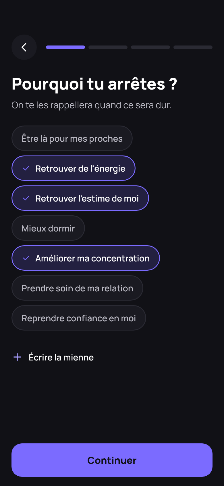

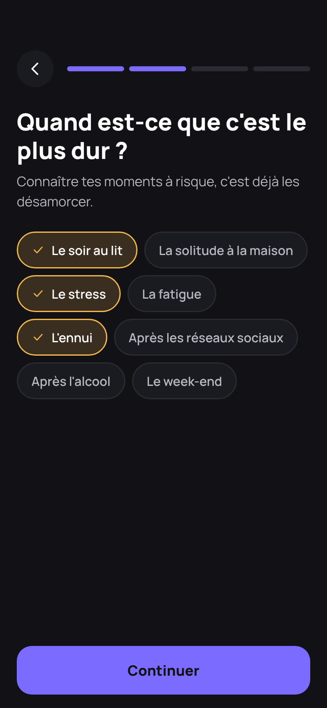

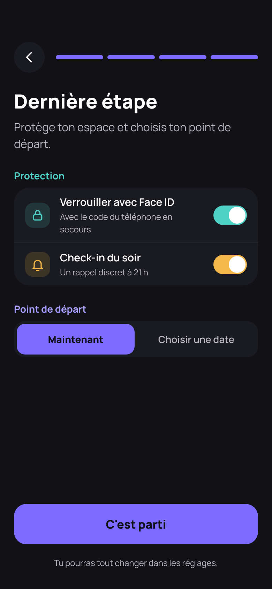

The welcome screen shows the brand lockup and the language pill at the top, then the first emblem of each circle in its color, the title, the promise and a gold clock beside "Deux minutes pour poser tes bases.". Reasons are chosen as violet chips and risk moments as gold ones. The plan step uses the plan editor. The start step shows "Point de départ" (section label, accent text) over its segmented control, and "Protection" (section label, teal) over a switch row for the lock (teal lock tile) and one for the evening check-in reminder (gold bell tile, "Un rappel discret à 21 h"), both off. Its subtitle reads "Protège ton espace et choisis ton point de départ.", and its footer "Tu pourras tout changer dans les réglages."

On Android, a filter step comes before the start, with the progress out of five: "Un filtre pour tout le téléphone", a subtitle, "Ce que fait le filtre" (section label, violet) over a card holding what it blocks and the disclosure in full (16/400, text color), and a line under it saying it can wait. At the bottom, "Accepter et activer" (primary), which opens Android's VPN dialog, and "Plus tard" (text button). Once on, the line reads "Le filtre est activé. Tu le retrouves dans les réglages." and the primary button becomes "Continuer".

### Home, first day

### Home

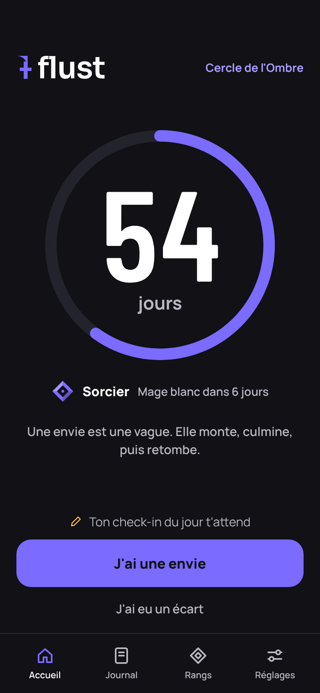

### Ranks

### Rank unlocked

### Emergency

### Help

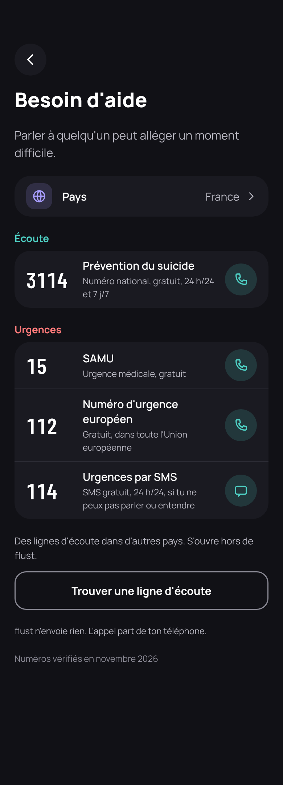

### Check-in

### Lapse

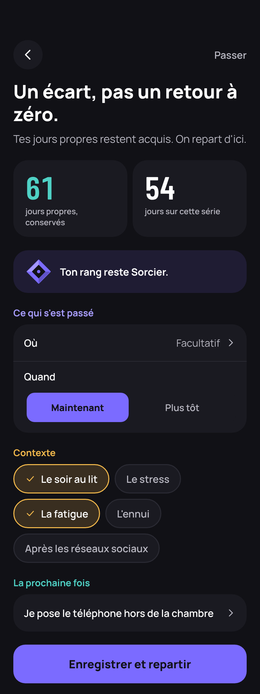

### Journal

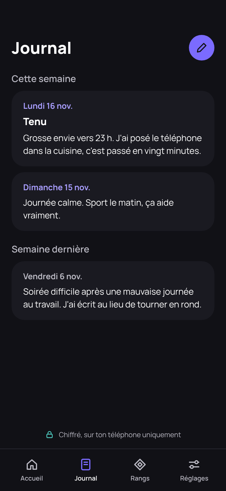

### Note

### Settings

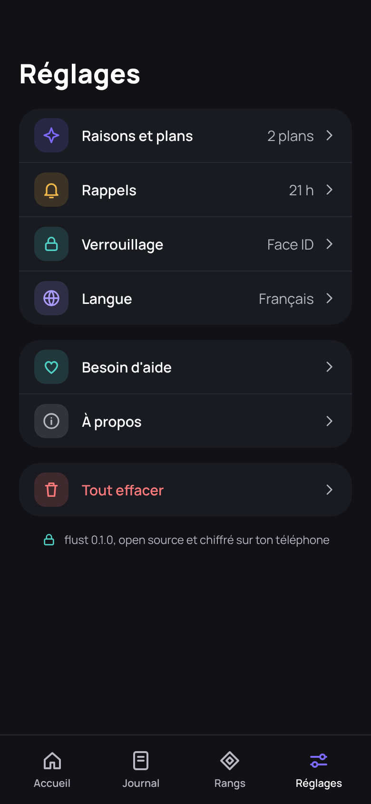

### Reasons and plans

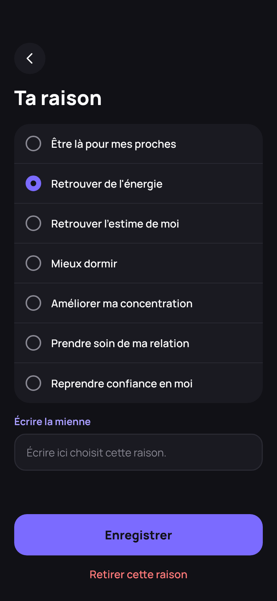

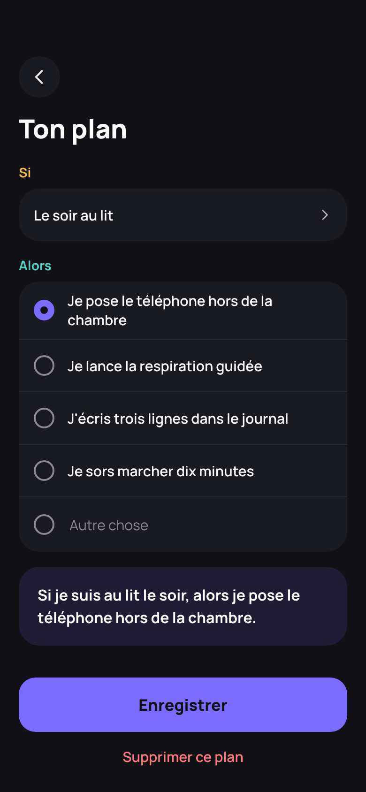

### Reminders

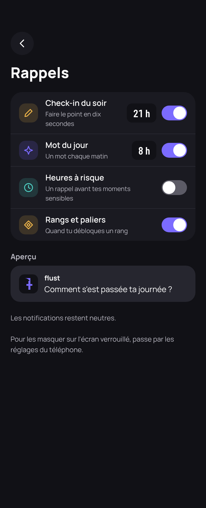

### Lock

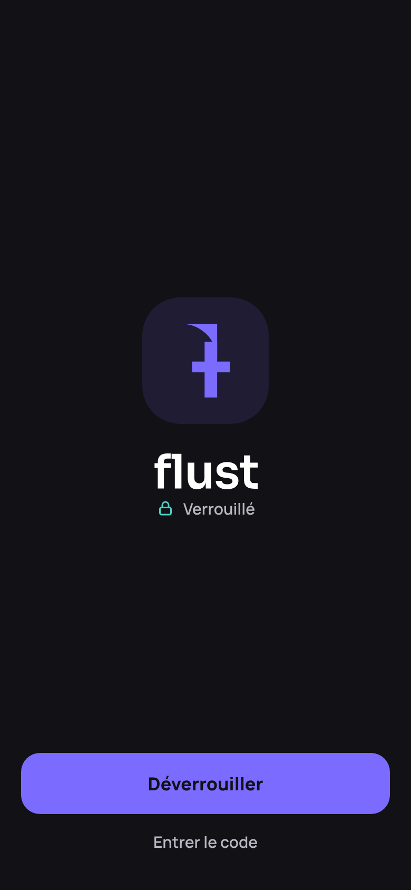

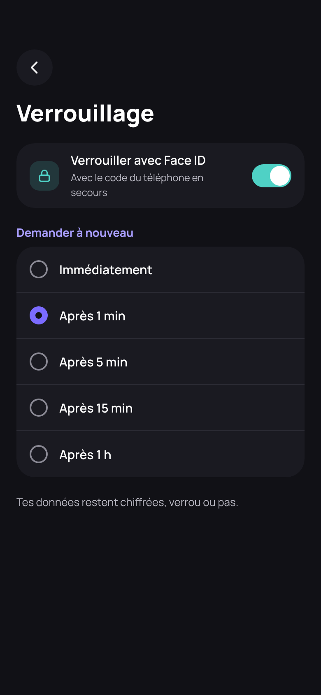

### About

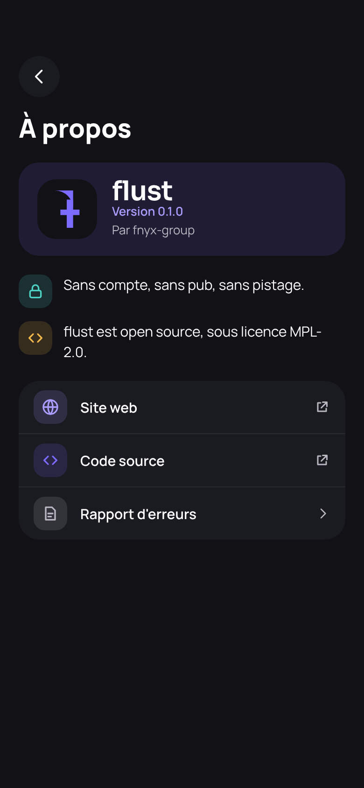

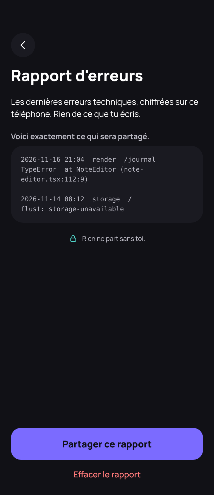

### Erase everything

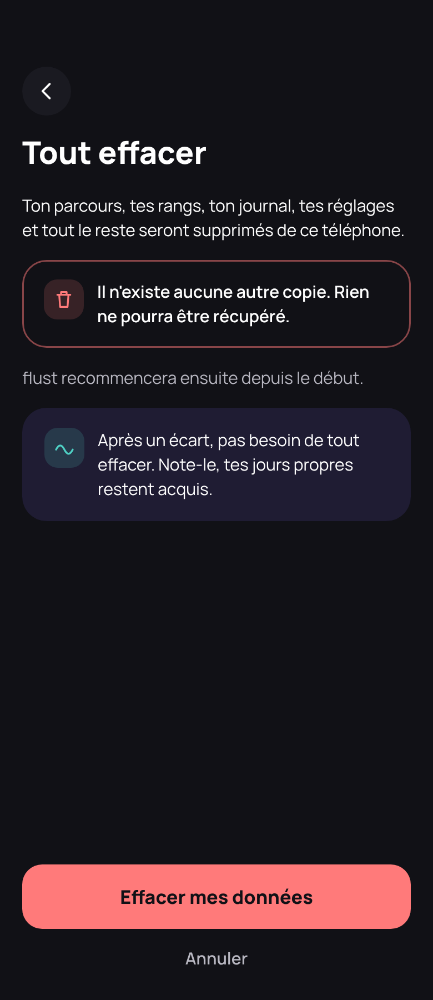
