# Design system

This document defines the visual language of flust: colors, typography, layout, navigation and tone. The app uses a single dark theme.

## Colors

| Token          | Value     | Use                       |
| -------------- | --------- | ------------------------- |
| Background     | `#111116` | Screen background         |
| Surface        | `#1A1A21` | Cards                     |
| Separator      | `#2A2A33` | Separators                |
| Locked         | `#5C5B66` | Locked ranks and emblems  |
| Secondary text | `#B9B8C2` | Labels and secondary text |
| Text           | `#FFFFFF` | Primary text              |
| Accent         | `#7B6BFF` | See below                 |

Text on the accent color is always `#111116`.

The accent is reserved for primary actions, progress, unlocked emblems and the active tab. It is not used for decoration.

No gradients. No emojis.

## Typography

Two typefaces, bundled with the app:

- Manrope, weights 400 to 800, for the whole interface.
- Barlow Condensed, weights 500 and 600, for numbers only.

Counters use tabular numbers so digits do not shift as they change.

| Style                            | Size  | Weight | Notes                 |
| -------------------------------- | ----- | ------ | --------------------- |
| Streak counter, 1 or 2 digits    | 240   | 600    | Barlow Condensed      |
| Streak counter, 3 digits         | 176   | 600    | Barlow Condensed      |
| Streak counter, 4 digits or more | 128   | 600    | Barlow Condensed      |
| Streak counter unit              | 40    | 600    | Secondary text color  |
| Welcome title                    | 40    | 800    | Onboarding welcome    |
| Brand lockup                     | 36    | 800    | Onboarding welcome    |
| Stepper value                    | 32    | 600    | Barlow Condensed      |
| Screen title                     | 28    | 800    |                       |
| Rank name                        | 22    | 800    |                       |
| Daily quote                      | 22    | 700    | Line height 30        |
| Calendar day                     | 18    | 500    | Barlow Condensed      |
| Select value                     | 17    | 800    | Value of a select row |
| Row                              | 15    | 600    |                       |
| Primary button                   | 17    | 800    | Text on accent        |
| Secondary button                 | 15    | 600    |                       |
| Body                             | 15-16 | 400    |                       |
| Section label                    | 16    | 600    | Secondary text color  |
| Label                            | 13    | 600    | Secondary text color  |
| Caption                          | 12    | 400    |                       |

The streak counter size depends on its number of digits, so it stays on one line on a 360 point wide screen. Hours and minutes count all their digits, with minutes always shown on two: "7 h 40" has 3 digits and uses 176, "12 h 05" has 4 and uses 128. Days use 240 up to 99, 176 up to 999, then 128. On narrower screens the counter shrinks further to fit. The counter does not grow with the system text size, since it is already the largest text on screen; the units and every other text do.

## Layout

| Element            | Value                         |
| ------------------ | ----------------------------- |
| Screen padding     | 20                            |
| Top padding        | 60                            |
| Cards              | Radius 20 to 22               |
| Primary button     | Height 58, radius 18          |
| Secondary button   | Height 48 to 50, radius 16    |
| Chips              | Pill shape                    |
| Segmented controls | Radius 16, segments radius 12 |
| Switches           | 48 by 28                      |
| Touch targets      | At least 44 by 44             |

## Navigation

The tab bar has four tabs: Home, Journal, Ranks and Settings. Tab icons are line icons. The active tab icon uses the accent color.

The emergency screen is not a tab. It is reached from the emergency button on the home screen.

The home header shows the flust symbol with the name next to it. The lock screen shows the same symbol and name, larger and centered.

## Notifications

Notifications are always neutral and never reveal what the app is about.

## Daily quotes

Daily quotes are either original lines written for flust or lines from public domain authors such as Epictetus, Seneca and Marcus Aurelius. Every quote is available in French and English.

Quotes from living authors are not used without their permission.

## Voice and wording

- Sentences are calm, plain and non-judgmental. They state what happened and what the user can do, without blame, alarm or pressure.
- French addresses the user with "tu".
- French text never assumes the user's gender. Use neutral nouns and phrasings instead of gendered adjectives and participles: "Le stress" rather than "Stressé", "La fatigue" rather than "Fatigué", "La solitude à la maison" rather than "Seul à la maison", "Retrouver l'estime de moi" rather than "Être fier de moi", "Être là pour mes proches" rather than "Être présent pour mes proches".
- French punctuation follows French typography: a narrow no-break space (U+202F) before "?", "!" and ";", and a no-break space (U+00A0) before ":", so the sign never wraps alone onto the next line. A test checks every French string.
- A lapse is "lapse" in English and "écart" in French. The interface never says "relapse" or "rechute".

## Screens

### Design system

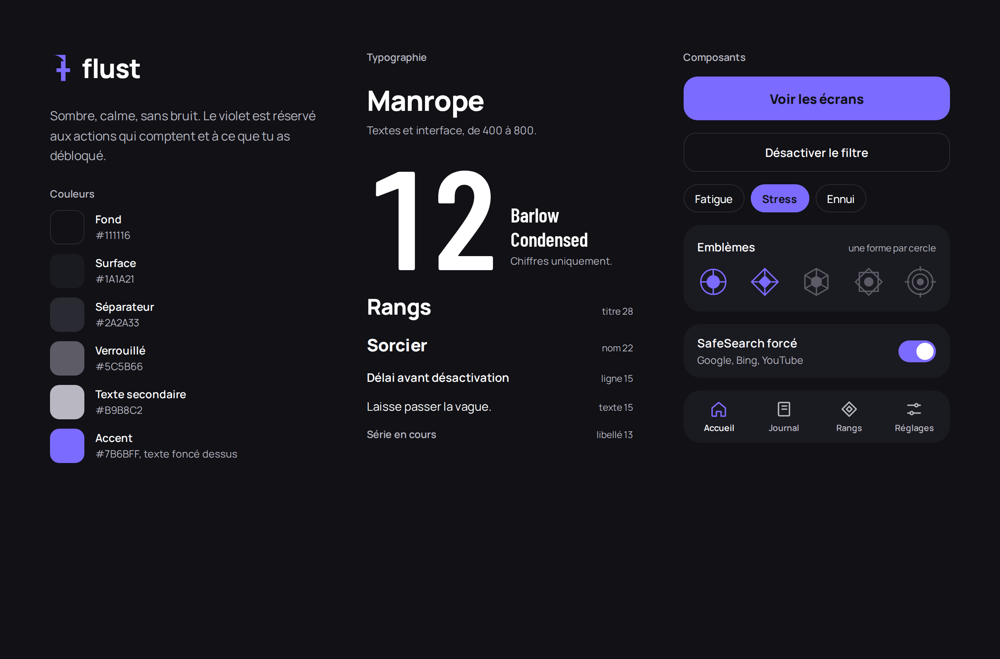

### Onboarding

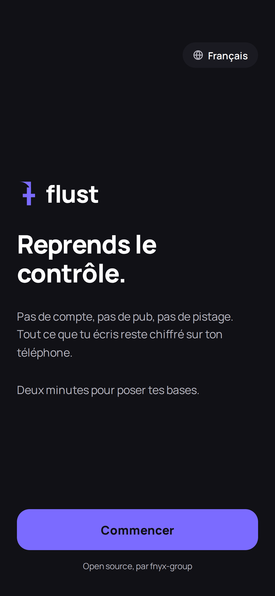

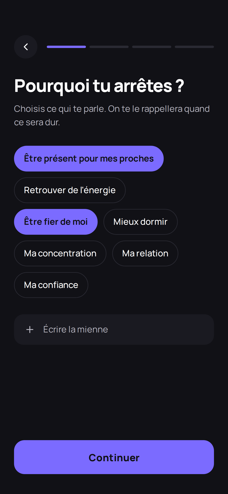

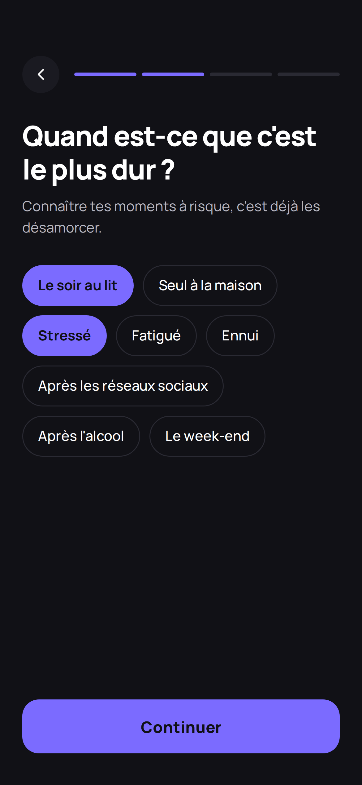

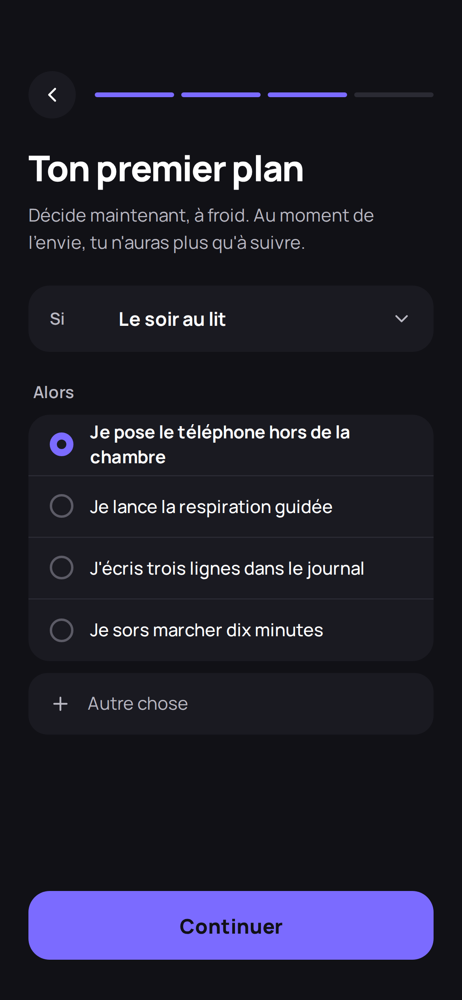

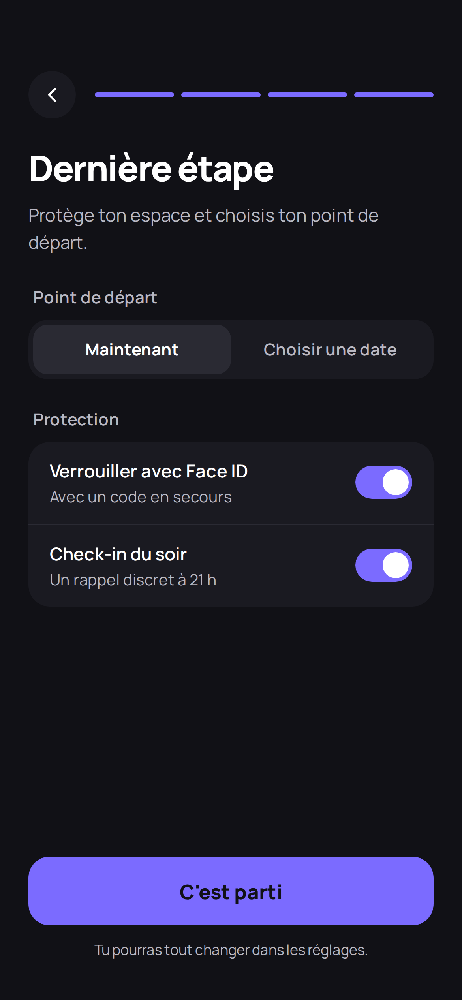

### Home, first day

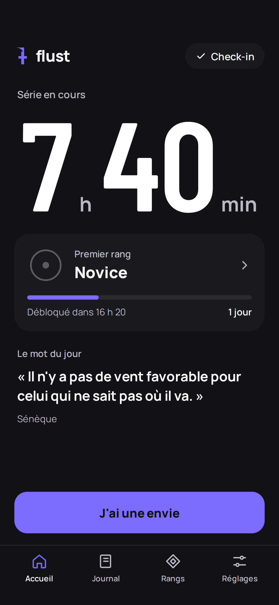

### Home

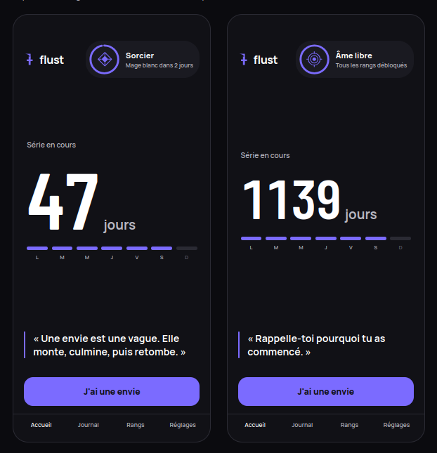

### Ranks

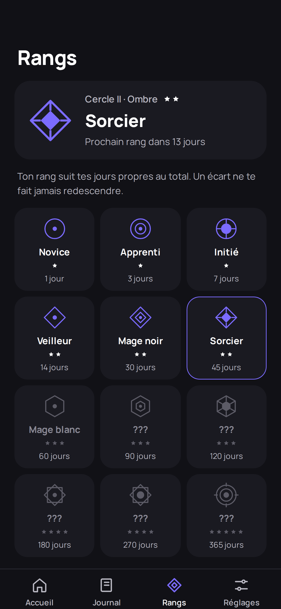

### Rank unlocked

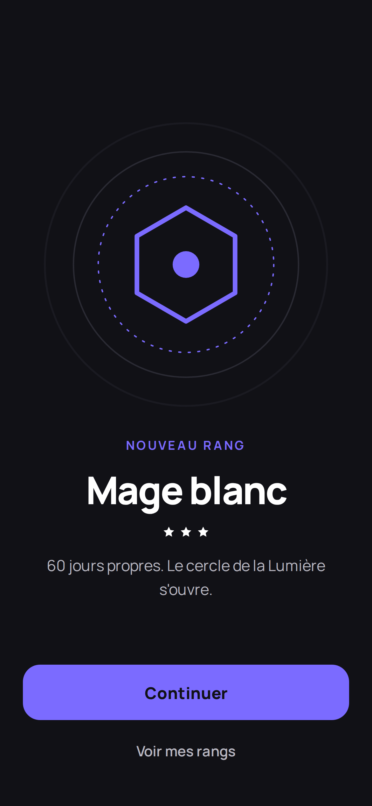

### Emergency

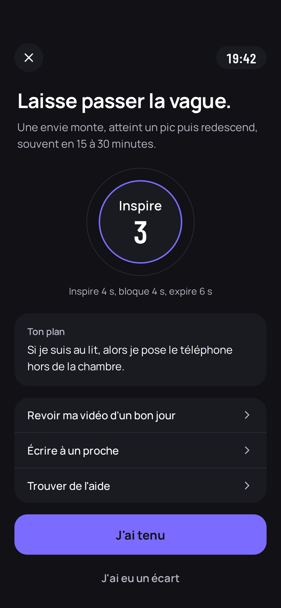

### Check-in

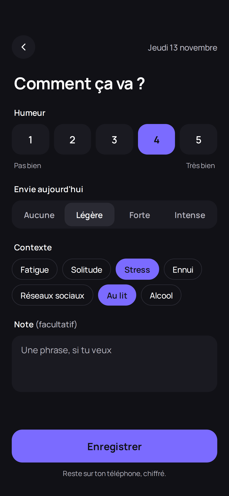

### Relapse

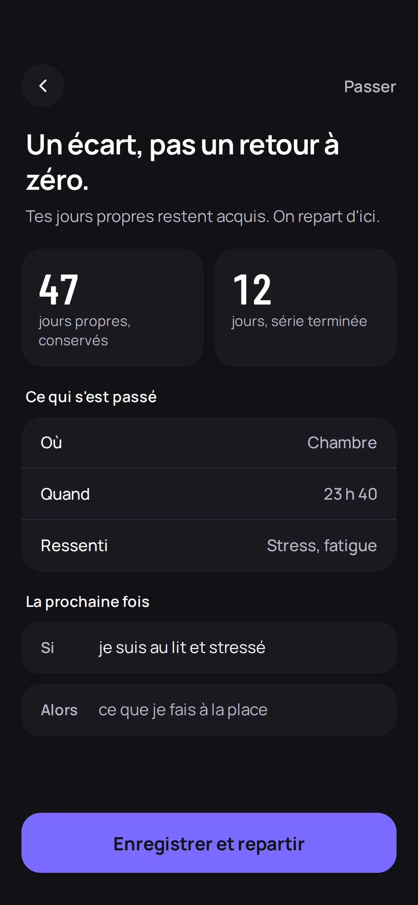

### Journal

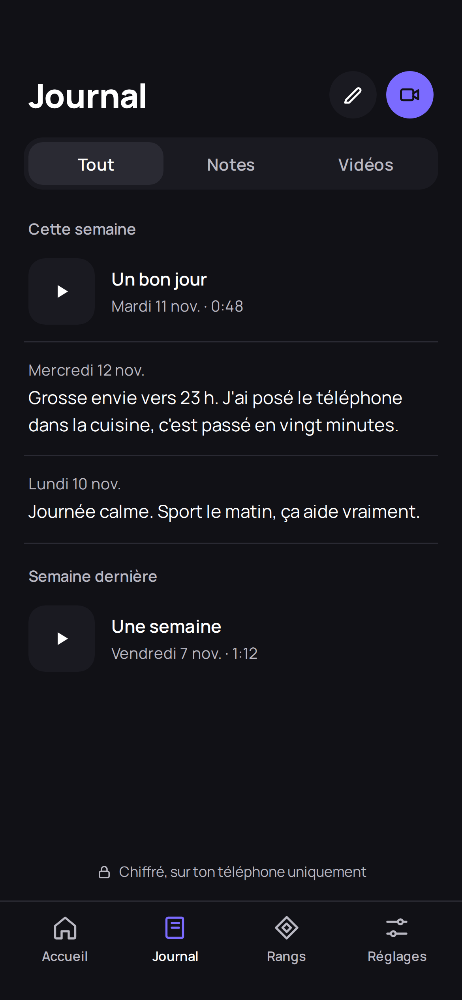

### Note

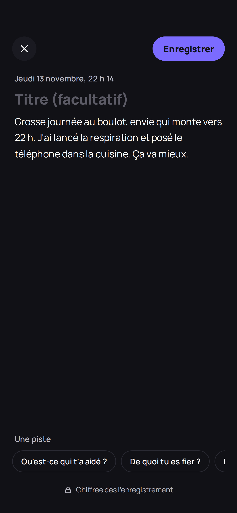

### Reasons and plans

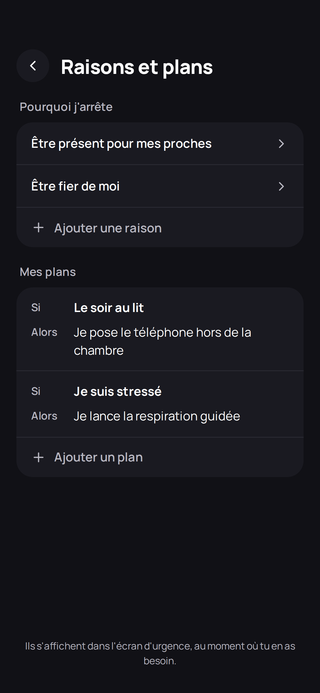

### Reminders

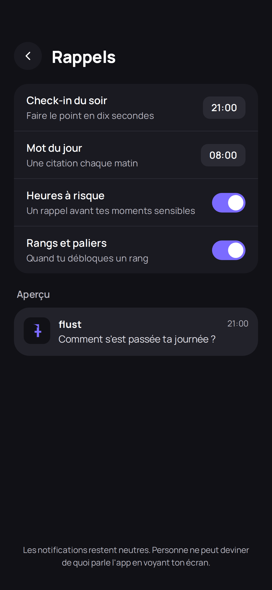

### Settings

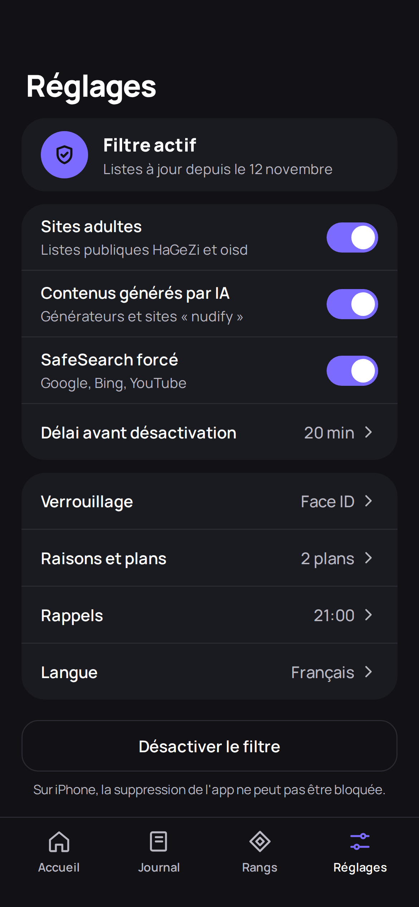

### Lock

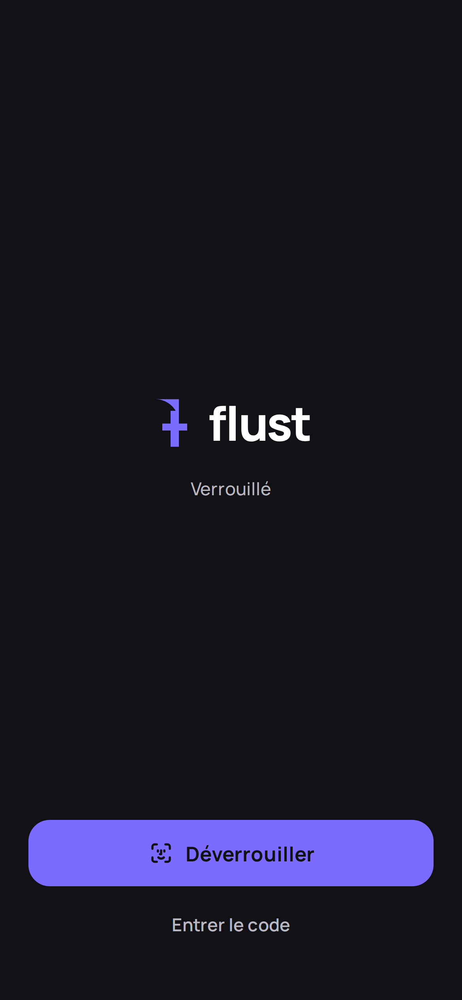
